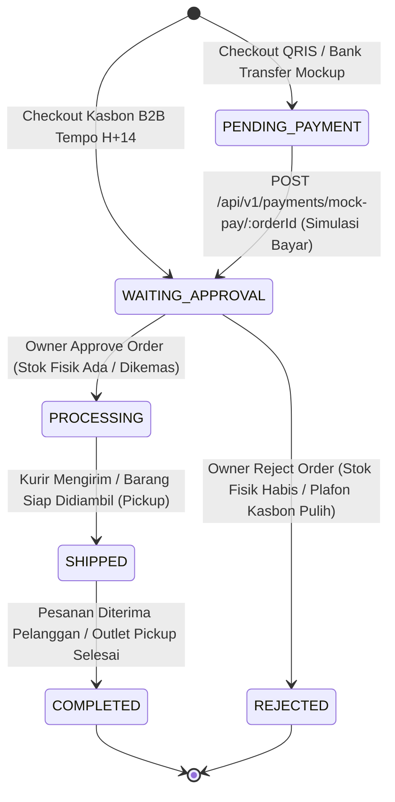

# ⚡ Spesifikasi & Arsitektur Backend: Belanja Produk hingga Checkout (Tijarah-3 B2B)

> Dokumen spesifikasi teknis arsitektur basis data, transaksi atomik, penetapan harga agen vs normal, opsi pengiriman, mockup payment gateway, fitur voucher diskon, alur verifikasi Owner, dwibahasa (i18n ID & EN), dan RESTful API untuk **Belanja Produk (E-Commerce B2B) hingga Checkout & Resi Pembelian** pada **Tijarah-3 (BC HNI 3 Bukittinggi)**.

---

## 1. Ringkasan Arsitektur & Business Rules

1. **Logika Penetapan Harga (Harga Agen vs Harga Normal)**:
   - **Jika `user.hniProfile !== null` (Agen HNI)**: Gunakan `agentPrice` + hitung `tpPoints` HNI.
   - **Jika `user.hniProfile === null` (Konsumen Umum)**: Gunakan `normalPrice` (HET / Retail) + Poin TP di-set `0`.
2. **Opsi Pengiriman (Diantar vs Pickup Toko)**:
   - **`DELIVERY`**: Memerlukan `addressId` valid & hitung `shippingCost`.
   - **`PICKUP`**: `addressId` opsional (`null`), `shippingCost = 0`, lokasi di-set `"Outlet BC HNI 3 Bukittinggi (Jl. Sudirman No. 45)"`.
3. **Fitur Voucher (Seeder Data & Calculation)**:
   - Backend memverifikasi kode voucher, masa berlaku, dan `minPurchase`.
   - Menghitung potongan `discountAmount` (Fixed, Percentage dengan `maxDiscount`, atau Shipping Subsidy).
4. **Alur Verifikasi Owner / Admin Toko**:
   - Setelah checkout, status awal pesanan adalah **`WAITING_APPROVAL`**.
   - Owner memverifikasi ketersediaan fisik stok produk di gudang:
     - **Approve (`POST /api/v1/admin/orders/:id/approve`)**: Status beralih ke **`PROCESSING`** (Dikemas).
     - **Reject (`POST /api/v1/admin/orders/:id/reject`)**: Status beralih ke **`REJECTED`** dengan `rejectionReason`.
       - *Pemulihan Kasbon B2B*: Jika bayar pakai `B2B_CREDIT`, saldo `currentBalance` yang terpotong otomatis dikembalikan & dicatat di `CreditLedgerEntry`.

---

## 2. State Machine Pesanan & Pembayaran



---

## 3. Inject Seeder Data Voucher (`promotions.Voucher`)

Backend menginjeksi data awal voucher promo pada tabel `vouchers`:

```typescript
// Data Injected Voucher Terdaftar di Database Backend
export const injectedVouchers = [
  {
    code: "DISKONHNI10K",
    title: "Voucher Diskon Rp 10.000 Herbal HNI",
    discountType: "FIXED",
    discountValue: 10000,
    minPurchase: 100000,
    maxDiscount: null,
    validUntil: "2026-12-31T23:59:59.000Z",
    isActive: true,
    description: "Potongan harga Rp 10.000 untuk minimal belanja produk HNI Rp 100.000",
  },
  {
    code: "AGENHNI15",
    title: "Diskon Khusus Agen 15%",
    discountType: "PERCENTAGE",
    discountValue: 15,
    minPurchase: 250000,
    maxDiscount: 50000,
    validUntil: "2026-12-31T23:59:59.000Z",
    isActive: true,
    description: "Diskon 15% maksimal Rp 50.000 untuk belanja minimal Rp 250.000",
  },
  {
    code: "FREEONGKIRBC3",
    title: "Subsidi Ongkir Rp 15.000 Kurir BC3",
    discountType: "SHIPPING_SUBSIDY",
    discountValue: 15000,
    minPurchase: 150000,
    maxDiscount: null,
    validUntil: "2026-12-31T23:59:59.000Z",
    isActive: true,
    description: "Subsidi ongkos kirim hingga Rp 15.000 khusus kurir lokal BC3 Bukittinggi",
  },
];
```

---

## 4. Spesifikasi Endpoint RESTful API

### A. Eksekusi Checkout (`POST /api/v1/checkout/process`)
- **Request Body**:
```json
{
  "shippingType": "DELIVERY",
  "addressId": "addr_998877",
  "shippingCourier": "LOCAL_BC3_DELIVERY",
  "shippingCost": 15000,
  "voucherCode": "DISKONHNI10K",
  "paymentMethod": "B2B_CREDIT",
  "notes": "Titip di toko herbal pasar atas",
  "items": [
    { "productId": "prod_mhs_100ml", "qty": 5 }
  ]
}
```

---

### B. Verification & Approval oleh Owner Toko

#### 1. Approve Pesanan (`POST /api/v1/admin/orders/:id/approve`)
- **Headers**: `Authorization: Bearer <token_admin_owner>`
- **Proses**:
  - Validasi pesanan `orderStatus === "WAITING_APPROVAL"`.
  - Update `orderStatus = "PROCESSING"` (Status berubah menjadi **Dikemas**).
- **Response `200 OK`**:
```json
{
  "status": "success",
  "message": "Pesanan berhasil disetujui. Status pesanan diperbarui menjadi PROCESSING (Dikemas).",
  "data": {
    "id": "ord_88776655",
    "orderNumber": "ORD/20260930/BC3-0089",
    "orderStatus": "PROCESSING"
  }
}
```

#### 2. Reject Pesanan (`POST /api/v1/admin/orders/:id/reject`)
- **Headers**: `Authorization: Bearer <token_admin_owner>`
- **Request Body**:
```json
{
  "rejectionReason": "Stok fisik Minyak Herba Sinergi di gudang BC3 saat ini habis."
}
```
- **Proses Atomik**:
  - Update `orderStatus = "REJECTED"`, simpan `rejectionReason`.
  - **Jika Payment B2B Kasbon**: Saldo plafon `currentBalance` yang terpotong otomatis dikembalikan (`currentBalance += totalAmount`, `usedBalance -= totalAmount`) dan dicatat mutasi `ADJUSTMENT` pada `CreditLedgerEntry`.
  - Re-stock kuantitas barang kembali ke database `products`.
- **Response `200 OK`**:
```json
{
  "status": "success",
  "message": "Pesanan berhasil ditolak. Saldo plafon kasbon B2B (jika ada) telah dikembalikan secara otomatis.",
  "data": {
    "id": "ord_88776655",
    "orderNumber": "ORD/20260930/BC3-0089",
    "orderStatus": "REJECTED",
    "rejectionReason": "Stok fisik Minyak Herba Sinergi di gudang BC3 saat ini habis."
  }
}
```

---

### C. Update Status Pengiriman & Selesai

#### 1. Kirim Paket (`POST /api/v1/admin/orders/:id/ship`)
- Update `orderStatus = "SHIPPED"` (Dalam Pengiriman / Siap Ambil di Outlet).

#### 2. Konfirmasi Selesai (`POST /api/v1/orders/:id/complete`)
- Update `orderStatus = "COMPLETED"` (Selesai).

---

### D. Get Resi Pembelian (`GET /api/v1/orders/:id/receipt`)
- **Response `200 OK`**:
```json
{
  "status": "success",
  "message": "Faktur resi pembelian berhasil diambil.",
  "data": {
    "id": "ord_88776655",
    "orderNumber": "ORD/20260930/BC3-0089",
    "userName": "Yudriqul Aulia",
    "hniMemberId": "03466846",
    "isAgentPriceApplied": true,
    "shippingType": "DELIVERY",
    "shippingAddressText": "Jl. Sudirman No. 45, Aur Birugo Tigo Baleh, Bukittinggi",
    "subtotal": 225000,
    "shippingCost": 15000,
    "discountAmount": 10000,
    "totalAmount": 230000,
    "totalTpPoints": 50,
    "paymentMethod": "B2B_CREDIT",
    "paymentStatus": "TEMPO_ACTIVE",
    "orderStatus": "PROCESSING",
    "rejectionReason": null,
    "dueDate": "2026-10-14T00:29:59.000Z",
    "createdAt": "2026-09-30T00:29:59.000Z",
    "items": [
      {
        "productId": "prod_mhs_100ml",
        "productName": "Minyak Herba Sinergi (MHS 100ml)",
        "qty": 5,
        "unitPrice": 45000,
        "tpPoints": 10,
        "totalPrice": 225000
      }
    ]
  }
}
```
