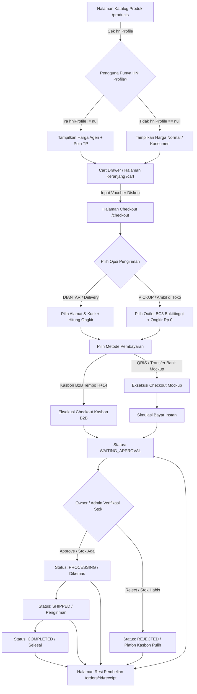

# 🛒 Spesifikasi & Panduan Frontend: Belanja Produk hingga Checkout (Tijarah-3 B2B)

> Dokumen spesifikasi teknis komponen UI, state management, alur transaksi, komponen reusable clean code, dwibahasa (i18n ID & EN), responsivitas, dark mode, fitur voucher diskon, alur verifikasi Owner, dan status pesanan pelanggan untuk **Belanja Produk (E-Commerce) hingga Checkout & Resi Pembelian** pada platform **Tijarah-3 (BC HNI 3 Bukittinggi)**.

---

## 1. Alur Pengguna & Status Lifecycle Pesanan



### Tabel Status Pesanan Pelanggan (Customer Order Status)
| Status Code | Label Bahasa Indonesia | Label English | Deskripsi & Perilaku FE |
|---|---|---|---|
| `PENDING_PAYMENT` | Menunggu Pembayaran | Pending Payment | Menampilkan countdown instruksi QRIS/Transfer Mockup & tombol simulasi bayar. |
| `WAITING_APPROVAL` | Menunggu Verifikasi Toko | Waiting Approval | Pesanan berhasil dibuat; Owner sedang memverifikasi fisik stok barang di gudang. |
| `PROCESSING` | Pesanan Dikemas | Processing / Packing | Owner telah menyetujui pesanan; paket sedang dikemas oleh tim BC3 Bukittinggi. |
| `SHIPPED` | Dalam Pengiriman / Siap Ambil | Shipped / Ready for Pickup | Paket diserahkan ke kurir atau siap diambil di outlet BC3 Bukittinggi. |
| `COMPLETED` | Selesai | Completed | Pesanan telah diterima pelanggan atau selesai diambil di outlet. |
| `REJECTED` | Ditolak oleh Toko | Rejected | Pesanan ditolak Owner (e.g. stok fisik habis). Menampilkan alasan penolakan & pemulihan saldo kasbon. |

---

## 2. Fitur Voucher Diskon & Logika Pengurangan

Frontend menyediakan komponen modal pemulihan **Voucher Diskon / Subsidi Ongkir** (`VoucherModal.tsx`):

### Jenis Voucher yang Didukung:
1. **`FIXED` (Potongan Nominal)**: Potongan langsung nominal rupiah (e.g. Diskon Rp 10.000).
2. **`PERCENTAGE` (Potongan Persentase)**: Potongan % dari subtotal belanja dengan batas maksimal potongan (`maxDiscount`).
3. **`SHIPPING_SUBSIDY` (Subsidi Ongkir)**: Potongan langsung pada biaya ongkos kirim.

```tsx
// Reusable Helper: Kalkulasi Diskon Voucher di Frontend
export const calculateVoucherDiscount = (
  voucher: { discountType: string; discountValue: number; maxDiscount?: number; minPurchase: number },
  subtotal: number,
  shippingCost: number
): number => {
  if (subtotal < voucher.minPurchase) return 0;

  if (voucher.discountType === "FIXED") {
    return Math.min(voucher.discountValue, subtotal);
  }

  if (voucher.discountType === "PERCENTAGE") {
    const calculated = (subtotal * voucher.discountValue) / 100;
    return voucher.maxDiscount ? Math.min(calculated, voucher.maxDiscount) : calculated;
  }

  if (voucher.discountType === "SHIPPING_SUBSIDY") {
    return Math.min(voucher.discountValue, shippingCost);
  }

  return 0;
};
```

---

## 3. Komponen Reusable Clean Code (Design System)

### A. Reusable Product Card Component (`ProductCard.tsx`)
Komponen card produk yang *clean*, responsif, mendukung Dark Mode, dwibahasa, serta ramah aksesibilitas.

```tsx
// src/components/molecule/ProductCard.tsx
import React from "react";
import Image from "next/image";
import { useTranslations } from "next-intl";
import { ShoppingBag, Sparkles } from "lucide-react";
import { TijarahButton } from "@/components/atom/tijarahButton";
import { TijarahBadge } from "@/components/atom/tijarahBadge";
import { formatCurrency } from "@/utils/formatters";

export interface ProductCardProps {
  id: string;
  name: string;
  category: string;
  agentPrice: number;
  normalPrice: number;
  tpPoints: number;
  stock: number;
  imageUrl?: string;
  isAgent: boolean;
  onAddToCart: (productId: string) => void;
  isLoading?: boolean;
}

export const ProductCard: React.FC<ProductCardProps> = ({
  id,
  name,
  category,
  agentPrice,
  normalPrice,
  tpPoints,
  stock,
  imageUrl,
  isAgent,
  onAddToCart,
  isLoading = false,
}) => {
  const t = useTranslations("catalog");
  const activePrice = isAgent ? agentPrice : normalPrice;
  const isOutOfStock = stock <= 0;

  return (
    <div className="group relative flex flex-col justify-between rounded-2xl border border-slate-200 dark:border-slate-800 bg-white dark:bg-slate-900 p-4 transition-all duration-300 hover:shadow-xl hover:border-emerald-500/30 dark:hover:border-emerald-500/30">
      {/* Top Badges */}
      <div className="flex items-center justify-between gap-2 mb-3">
        <TijarahBadge variant={isAgent ? "success" : "neutral"} className="text-[11px] font-semibold">
          {isAgent ? t("agentPriceBadge") : t("normalPriceBadge")}
        </TijarahBadge>

        {isAgent && tpPoints > 0 && (
          <span className="flex items-center gap-1 text-[11px] font-extrabold text-amber-600 dark:text-amber-400 bg-amber-50 dark:bg-amber-950/50 px-2 py-0.5 rounded-full border border-amber-200/50 dark:border-amber-800/50">
            <Sparkles className="w-3 h-3 text-amber-500" />
            {tpPoints} {t("tpPointsLabel")}
          </span>
        )}
      </div>

      {/* Product Image */}
      <div className="relative aspect-square w-full rounded-xl overflow-hidden bg-slate-100 dark:bg-slate-800/60 mb-3 flex items-center justify-center">
        {imageUrl ? (
          <Image
            src={imageUrl}
            alt={name}
            fill
            className="object-cover group-hover:scale-105 transition-transform duration-300"
          />
        ) : (
          <ShoppingBag className="w-12 h-12 text-slate-400 dark:text-slate-600" />
        )}
      </div>

      {/* Product Content */}
      <div className="flex flex-col flex-1 gap-1 mb-4">
        <span className="text-[11px] font-medium text-slate-400 dark:text-slate-500 uppercase tracking-wider">
          {category}
        </span>
        <h3 className="text-sm font-bold text-slate-900 dark:text-slate-100 line-clamp-2 leading-snug group-hover:text-emerald-600 dark:group-hover:text-emerald-400 transition-colors">
          {name}
        </h3>
        
        {/* Price Tag */}
        <div className="mt-2 flex items-baseline gap-2">
          <span className="text-base sm:text-lg font-black text-emerald-600 dark:text-emerald-400">
            {formatCurrency(activePrice)}
          </span>
          {isAgent && normalPrice > agentPrice && (
            <span className="text-xs text-slate-400 line-through">
              {formatCurrency(normalPrice)}
            </span>
          )}
        </div>
      </div>

      {/* Action Button */}
      <TijarahButton
        type="button"
        onClick={() => onAddToCart(id)}
        isDisabled={isOutOfStock || isLoading}
        isLoading={isLoading}
        tijarahVariant={isOutOfStock ? "ghost" : "primary"}
        className="w-full text-xs sm:text-sm font-bold py-2.5 flex items-center justify-center gap-2"
      >
        <ShoppingBag className="w-4 h-4" />
        <span>{isOutOfStock ? t("outOfStock") : t("addToCart")}</span>
      </TijarahButton>
    </div>
  );
};
```

---

### B. Reusable Order Receipt Card Component (`CheckoutReceiptCard.tsx`)
Komponen resi faktur pembelian yang mendukung perbaruan status verifikasi Owner (termasuk alasan penolakan):

```tsx
// src/components/organism/CheckoutReceiptCard.tsx
import React from "react";
import { useTranslations } from "next-intl";
import { Printer, CheckCircle2, Clock, MapPin, Truck, AlertOctagon, XCircle } from "lucide-react";
import { TijarahButton } from "@/components/atom/tijarahButton";
import { TijarahBadge } from "@/components/atom/tijarahBadge";
import { formatCurrency, formatDate } from "@/utils/formatters";
import { OrderReceiptResponse } from "@/modules/checkout/types/checkout.types";

export const CheckoutReceiptCard: React.FC<{ receipt: OrderReceiptResponse }> = ({ receipt }) => {
  const t = useTranslations("receipt");

  const getOrderStatusBadge = (status: string) => {
    switch (status) {
      case "WAITING_APPROVAL":
        return <TijarahBadge variant="warning">{t("statusWaitingApproval")}</TijarahBadge>;
      case "PROCESSING":
        return <TijarahBadge variant="info">{t("statusProcessing")}</TijarahBadge>;
      case "SHIPPED":
        return <TijarahBadge variant="info">{t("statusShipped")}</TijarahBadge>;
      case "COMPLETED":
        return <TijarahBadge variant="success">{t("statusCompleted")}</TijarahBadge>;
      case "REJECTED":
        return <TijarahBadge variant="danger">{t("statusRejected")}</TijarahBadge>;
      default:
        return <TijarahBadge variant="neutral">{status}</TijarahBadge>;
    }
  };

  return (
    <div className="w-full max-w-2xl mx-auto rounded-2xl border border-slate-200 dark:border-slate-800 bg-white dark:bg-slate-900 p-6 shadow-xl print:shadow-none print:border-none print:p-0">
      {/* Header Resi */}
      <div className="flex flex-col sm:flex-row items-start sm:items-center justify-between gap-4 border-b border-slate-200 dark:border-slate-800 pb-5">
        <div>
          <span className="text-xs font-bold text-emerald-600 dark:text-emerald-400 uppercase tracking-widest">
            {t("brandName")}
          </span>
          <h2 className="text-xl font-black text-slate-900 dark:text-slate-100">
            {t("invoiceTitle")} #{receipt.orderNumber}
          </h2>
          <p className="text-xs text-slate-500 mt-0.5">
            {formatDate(receipt.createdAt)}
          </p>
        </div>

        <div className="flex items-center gap-2 print:hidden">
          {getOrderStatusBadge(receipt.orderStatus)}
          <TijarahButton
            type="button"
            tijarahVariant="outline"
            onClick={() => window.print()}
            className="text-xs font-bold px-4 py-2 flex items-center gap-2"
          >
            <Printer className="w-4 h-4" />
            <span>{t("printBtn")}</span>
          </TijarahButton>
        </div>
      </div>

      {/* Warning Box jika Ditolak oleh Owner */}
      {receipt.orderStatus === "REJECTED" && (
        <div className="my-4 p-4 rounded-xl border border-rose-500/30 bg-rose-50 dark:bg-rose-950/30 text-rose-800 dark:text-rose-300 flex items-start gap-3">
          <XCircle className="w-5 h-5 shrink-0 text-rose-600 dark:text-rose-400 mt-0.5" />
          <div className="text-xs">
            <p className="font-bold">{t("rejectedTitle")}</p>
            <p className="mt-0.5">{receipt.rejectionReason || t("defaultRejectionReason")}</p>
          </div>
        </div>
      )}

      {/* Info Status & Pengiriman */}
      <div className="grid grid-cols-1 sm:grid-cols-2 gap-4 my-5 p-4 rounded-xl bg-slate-50 dark:bg-slate-800/50">
        <div>
          <span className="text-xs text-slate-400">{t("buyerName")}</span>
          <p className="text-sm font-bold text-slate-900 dark:text-slate-100">
            {receipt.userName} {receipt.hniMemberId && `(ID: ${receipt.hniMemberId})`}
          </p>
        </div>

        <div>
          <span className="text-xs text-slate-400">{t("shippingType")}</span>
          <p className="text-sm font-bold text-slate-900 dark:text-slate-100 flex items-center gap-1.5">
            {receipt.shippingType === "DELIVERY" ? <Truck className="w-4 h-4 text-emerald-500" /> : <MapPin className="w-4 h-4 text-amber-500" />}
            {receipt.shippingType === "DELIVERY" ? t("deliveryCourier") : t("pickupStore")}
          </p>
        </div>
      </div>

      {/* Rincian Produk */}
      <div className="divide-y divide-slate-100 dark:divide-slate-800 border-t border-b border-slate-200 dark:border-slate-800 my-4">
        {receipt.items.map((item, idx) => (
          <div key={idx} className="py-3 flex items-center justify-between text-xs sm:text-sm">
            <div>
              <p className="font-bold text-slate-900 dark:text-slate-100">{item.productName}</p>
              <p className="text-slate-400 text-xs">
                {item.qty} x {formatCurrency(item.unitPrice)}
                {item.tpPoints > 0 && <span className="ml-2 text-amber-600 font-semibold">({item.tpPoints * item.qty} TP)</span>}
              </p>
            </div>
            <span className="font-extrabold text-slate-900 dark:text-slate-100">
              {formatCurrency(item.totalPrice)}
            </span>
          </div>
        ))}
      </div>

      {/* Summary Calculation */}
      <div className="flex flex-col gap-2 pt-2 text-xs sm:text-sm">
        <div className="flex justify-between text-slate-500">
          <span>{t("subtotal")}</span>
          <span>{formatCurrency(receipt.subtotal)}</span>
        </div>
        <div className="flex justify-between text-slate-500">
          <span>{t("shippingCost")}</span>
          <span>{formatCurrency(receipt.shippingCost)}</span>
        </div>
        {receipt.discountAmount > 0 && (
          <div className="flex justify-between text-emerald-600 font-semibold">
            <span>{t("discount")}</span>
            <span>-{formatCurrency(receipt.discountAmount)}</span>
          </div>
        )}
        <div className="flex justify-between text-base font-black text-slate-900 dark:text-slate-100 pt-2 border-t border-slate-200 dark:border-slate-800">
          <span>{t("grandTotal")}</span>
          <span className="text-emerald-600 dark:text-emerald-400">{formatCurrency(receipt.totalAmount)}</span>
        </div>
      </div>
    </div>
  );
};
```

---

## 4. Kamus i18n Dwibahasa (Indonesian & English)

```json
// src/i18n/locales/id.json
{
  "receipt": {
    "brandName": "TIJARAH-3 BUKITTINGGI",
    "invoiceTitle": "FAKTUR PEMBELIAN",
    "printBtn": "Cetak / Simpan PDF",
    "buyerName": "Nama Pembeli / Agen",
    "shippingType": "Metode Pengadaan",
    "deliveryCourier": "Diantar (Kurir Ekspres)",
    "pickupStore": "Ambil Sendiri di Outlet BC3",
    "statusWaitingApproval": "Menunggu Verifikasi Toko",
    "statusProcessing": "Pesanan Dikemas",
    "statusShipped": "Dalam Pengiriman",
    "statusCompleted": "Pesanan Selesai",
    "statusRejected": "Ditolak oleh Toko",
    "rejectedTitle": "Pesanan ini ditolak oleh Owner Toko",
    "defaultRejectionReason": "Stok fisik produk di gudang habis.",
    "subtotal": "Subtotal Produk",
    "shippingCost": "Ongkos Kirim",
    "discount": "Diskon Voucher",
    "grandTotal": "Total Pembayaran"
  }
}
```

```json
// src/i18n/locales/en.json
{
  "receipt": {
    "brandName": "TIJARAH-3 BUKITTINGGI",
    "invoiceTitle": "PURCHASE INVOICE",
    "printBtn": "Print / Save PDF",
    "buyerName": "Buyer / Agent Name",
    "shippingType": "Fulfillment Method",
    "deliveryCourier": "Delivery (Express Courier)",
    "pickupStore": "Store Pickup at BC3",
    "statusWaitingApproval": "Waiting Approval",
    "statusProcessing": "Processing / Packing",
    "statusShipped": "Shipped",
    "statusCompleted": "Completed",
    "statusRejected": "Rejected by Store",
    "rejectedTitle": "This order was rejected by Store Owner",
    "defaultRejectionReason": "Physical product stock in warehouse is out of stock.",
    "subtotal": "Product Subtotal",
    "shippingCost": "Shipping Fee",
    "discount": "Voucher Discount",
    "grandTotal": "Grand Total"
  }
}
```

---

## 5. Kamus Tipe TypeScript (Interfaces & Types)

```typescript
// src/modules/checkout/types/checkout.types.ts

export type OrderStatusType =
  | "PENDING_PAYMENT"
  | "WAITING_APPROVAL"
  | "PROCESSING"
  | "SHIPPED"
  | "COMPLETED"
  | "REJECTED"
  | "CANCELLED";

export type ShippingType = "DELIVERY" | "PICKUP";
export type PaymentMethodType = "B2B_CREDIT" | "QRIS_MOCKUP" | "BANK_TRANSFER_MOCKUP" | "CASH_STORE";

export interface CheckoutPayload {
  shippingType: ShippingType;
  addressId?: string;
  shippingCourier?: string;
  shippingCost: number;
  voucherCode?: string;
  paymentMethod: PaymentMethodType;
  notes?: string;
  items: {
    productId: string;
    qty: number;
  }[];
}

export interface OrderReceiptResponse {
  id: string;
  orderNumber: string;
  userName: string;
  hniMemberId?: string;
  isAgentPriceApplied: boolean;
  shippingType: ShippingType;
  shippingAddressText?: string;
  subtotal: number;
  shippingCost: number;
  discountAmount: number;
  totalAmount: number;
  totalTpPoints: number;
  paymentMethod: PaymentMethodType;
  paymentStatus: "UNPAID" | "PAID" | "TEMPO_ACTIVE";
  orderStatus: OrderStatusType;
  rejectionReason?: string;
  dueDate?: string;
  createdAt: string;
  items: {
    productId: string;
    productName: string;
    qty: number;
    unitPrice: number;
    tpPoints: number;
    totalPrice: number;
  }[];
}
```
