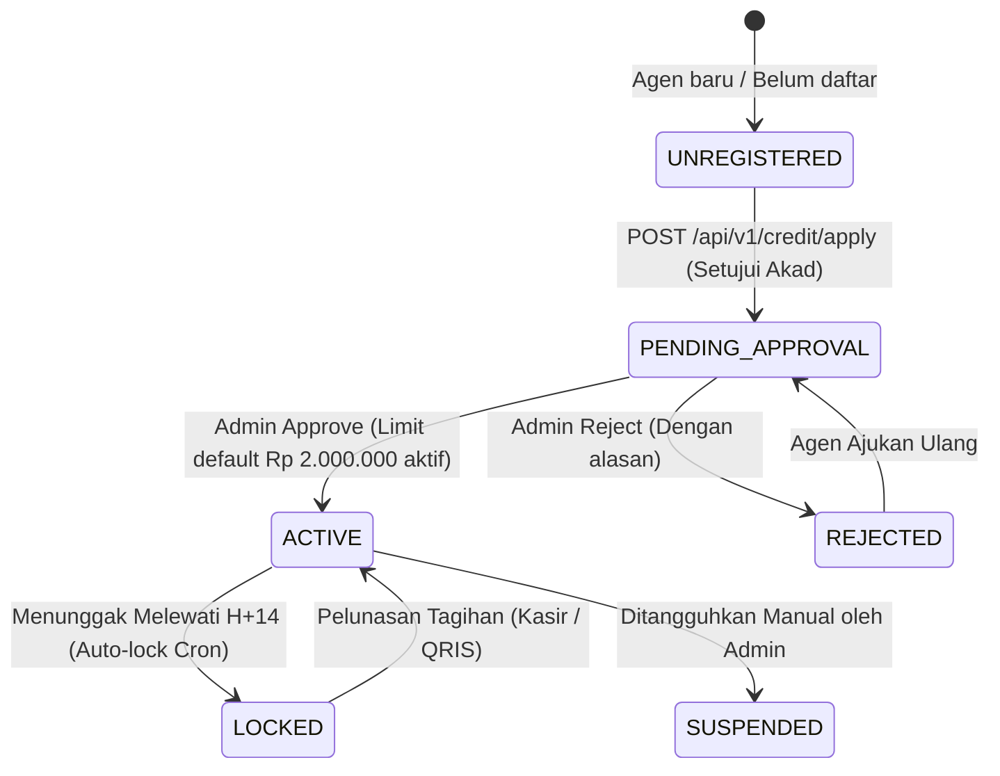

# 📋 Spesifikasi Backend: Fasilitas Belanja Tempo (Kasbon B2B Toko)

> Dokumen spesifikasi teknis arsitektur basis data, state machine, dan RESTful API untuk fitur **Kasbon / Kredit B2B Tempo H+14** pada platform e-commerce dan back-office **TIJARAH-3 (BC HNI 3 Bukittinggi)**.

---

## 1. Ringkasan & Aturan Bisnis (Business Rules)

1. **Bukan Akses Otomatis Langsung Terbuka**:
   - Pengguna baru tidak langsung mendapatkan akses tempo secara instan.
   - Pengguna harus melalui **alur pendaftaran & kurasi persetujuan Admin**.
2. **Persyaratan Simpel (Tanpa Birokrasi Ribet)**:
   - Karena platform sudah memiliki data agen HNI terverifikasi (`hniMemberId`, `hniMemberName`, `rank`, `phoneNumber`, alamat), pengguna **tidak perlu mengunggah berkas identitas ulang**.
   - Pengguna hanya perlu menyetujui **Akad Belanja Tempo (Qardh Syariah B2B)** dan mengonfirmasi pengajuan.
3. **Plafon Awal & Tenor Standar**:
   - **Nominal Plafon Awal Default**: **Rp 2.000.000** (Dua Juta Rupiah).
   - **Jatuh Tempo (Tenor)**: **H+14** (Maksimal 14 hari kalender terhitung sejak faktur belanja diterbitkan).
   - Bebas bunga dan denda tambahan (Akad Qardh).
4. **Alur Kurasi & Seleksi Agen**:
   - Admin Toko / Keuangan BC 3 Bukittinggi berhak memilih dan menyetujui agen yang memiliki rekam jejak aktif belanja produk HNI.
   - Status beralih ke `ACTIVE` saat disetujui, dan baru dapat digunakan sebagai metode pembayaran di keranjang/kasir.
5. **Auto-Lock H+14**:
   - Jika ada tagihan yang belum dilunasi melewati H+14, sistem secara otomatis mengunci akun (`isLocked: true`, status: `LOCKED`) sehingga opsi pembayaran tempo tidak dapat digunakan kembali hingga pelunasan dilakukan.

---

## 2. State Machine Status Akun Kasbon



| Status | Deskripsi | Perilaku di Frontend |
|---|---|---|
| `UNREGISTERED` | Belum pernah mengajukan plafon kasbon. | Menampilkan gerbang edukasi & formulir pengajuan + akad qardh. |
| `PENDING_APPROVAL` | Pengajuan sedang dalam antrean kurasi admin. | Menampilkan kartu status verifikasi (Estimasi 1x24 jam kerja), seluruh form terkunci. |
| `ACTIVE` | Pengajuan disetujui, limit aktif Rp 2.000.000. | Menampilkan dashboard plafon, progress bar, ledger transaksi, dan opsi pembayaran tempo di keranjang belanja. |
| `REJECTED` | Pengajuan ditolak oleh admin. | Menampilkan catatan alasan penolakan dan tombol **Ajukan Ulang**. |
| `LOCKED` | Terkunci otomatis karena tunggakan jatuh tempo > H+14. | Menampilkan peringatan merah bahaya; tombol bayar tagihan aktif, opsi belanja tempo dinonaktifkan. |
| `SUSPENDED` | Dibekukan sementara oleh admin pusat. | Transaksi tempo dihentikan sementara. |

---

## 3. Skema Basis Data (Prisma Schema Reference)

```prisma
// Status Akun Kasbon
enum CreditAccountStatus {
  UNREGISTERED
  PENDING_APPROVAL
  ACTIVE
  REJECTED
  LOCKED
  SUSPENDED
}

// Jenis Mutasi Buku Besar Kasbon
enum CreditLedgerType {
  DISBURSEMENT   // Pengambilan barang tempo (saldo terpakai bertambah)
  REPAYMENT      // Pembayaran / pelunasan kasbon (saldo terpakai berkurang)
  ADJUSTMENT     // Penyesuaian koreksi manual oleh admin
}

// 1. Akun Plafon Kredit B2B
model B2BCreditAccount {
  id              String               @id @default(cuid())
  userId          String               @unique
  user            User                 @relation(fields: [userId], references: [id], onDelete: Cascade)
  status          CreditAccountStatus  @default(UNREGISTERED)
  creditLimit     Decimal              @default(2000000.00) @db.Decimal(12, 2)
  currentBalance  Decimal              @default(2000000.00) @db.Decimal(12, 2) // Sisa limit tersedia
  usedBalance     Decimal              @default(0.00) @db.Decimal(12, 2)       // Total tagihan berjalan
  dueDate         DateTime?            // Tanggal jatuh tempo faktur tertua
  isLocked        Boolean              @default(false)
  postingMode     String               @default("STRICT_HOLD") // STRICT_HOLD | TRUSTED_VIP
  
  appliedAt       DateTime?
  approvedAt      DateTime?
  approvedBy      String?              // Admin userId yang menyetujui
  rejectedAt      DateTime?
  rejectionReason String?              @db.Text

  createdAt       DateTime             @default(now())
  updatedAt       DateTime             @updatedAt

  applications    CreditApplication[]
  ledgerEntries   CreditLedger[]

  @@index([userId])
  @@index([status])
}

// 2. Histori / Berkas Pengajuan Kasbon
model CreditApplication {
  id                 String           @id @default(cuid())
  creditAccountId    String
  creditAccount      B2BCreditAccount @relation(fields: [creditAccountId], references: [id], onDelete: Cascade)
  userId             String
  requestedLimit     Decimal          @default(2000000.00) @db.Decimal(12, 2)
  purpose            String?          // e.g. "Restock Rutin Produk Herbal HNI"
  alternativePhone   String?
  agreementAccepted  Boolean          @default(true)
  status             CreditAccountStatus @default(PENDING_APPROVAL)
  reviewedBy         String?
  reviewedAt         DateTime?
  adminNotes         String?          @db.Text

  createdAt          DateTime         @default(now())
  updatedAt          DateTime         @updatedAt

  @@index([creditAccountId])
  @@index([userId])
}

// 3. Mutasi Piutang & Faktur Tempo (Credit Ledger)
model CreditLedger {
  id              String           @id @default(cuid())
  creditAccountId String
  creditAccount   B2BCreditAccount @relation(fields: [creditAccountId], references: [id], onDelete: Cascade)
  type            CreditLedgerType
  amount          Decimal          @db.Decimal(12, 2)
  runningBalance  Decimal          @db.Decimal(12, 2)
  referenceNo     String?          // e.g. "INV/2026/09/BC3-0042" atau "PAY/2026/09/BC3-0012"
  description     String
  orderId         String?          // Relasi opsional ke tabel Order
  
  createdAt       DateTime         @default(now())

  items           CreditLedgerItem[]

  @@index([creditAccountId])
  @@index([referenceNo])
}

// 4. Rincian Produk Item pada Faktur Tempo
model CreditLedgerItem {
  id              String        @id @default(cuid())
  ledgerId        String
  ledger          CreditLedger  @relation(fields: [ledgerId], references: [id], onDelete: Cascade)
  productId       String?
  productName     String
  qty             Int
  unitPrice       Decimal       @db.Decimal(12, 2)
  tpPoints        Int           @default(0)
  totalPrice      Decimal       @db.Decimal(12, 2)

  @@index([ledgerId])
}
```

---

## 4. Spesifikasi Endpoint RESTful API

### A. Endpoint Sisi Pengguna (Client / Frontend)

#### 1. Mengambil Status Akun Kasbon Pengguna
- **Method & Path**: `GET /api/v1/credit/account/:userId`
- **Auth**: Bearer Token (User atau Admin)
- **Response `200 OK`**:
```json
{
  "status": "success",
  "data": {
    "id": "cred_cm42xyz01",
    "userId": "usr_998877",
    "status": "PENDING_APPROVAL",
    "creditLimit": 2000000,
    "currentBalance": 2000000,
    "usedBalance": 0,
    "dueDate": null,
    "isLocked": false,
    "postingMode": "STRICT_HOLD",
    "appliedAt": "2026-09-28T10:15:30.000Z",
    "approvedAt": null,
    "rejectionReason": null
  }
}
```
*Catatan: Jika pengguna belum pernah mengajukan, backend dapat mengembalikan `status: "UNREGISTERED"`.*

---

#### 2. Mengajukan Aktivasi Plafon Kasbon B2B
- **Method & Path**: `POST /api/v1/credit/apply`
- **Auth**: Bearer Token
- **Request Body**:
```json
{
  "requestedLimit": 2000000,
  "purpose": "Restock Rutin Produk Herbal HNI",
  "alternativePhone": "081377889900",
  "agreementAccepted": true
}
```
- **Validasi Backend (Zod / Joi)**:
  - `requestedLimit`: Number, min 500.000, max 5.000.000 (default: 2.000.000).
  - `agreementAccepted`: Boolean, wajib bernilai `true`.
  - User wajib memiliki profil agen HNI yang valid (`hniMemberId` terisi).
- **Proses Backend**:
  1. Buat record atau update `B2BCreditAccount` dengan `status = "PENDING_APPROVAL"` dan `appliedAt = NOW()`.
  2. Masukkan log ke tabel `CreditApplication`.
  3. Kirim notifikasi / webhook ke tim internal admin.
- **Response `201 Created`**:
```json
{
  "status": "success",
  "message": "Pengajuan plafon kasbon berhasil dikirim dan sedang dalam antrean verifikasi admin.",
  "data": {
    "id": "cred_cm42xyz01",
    "userId": "usr_998877",
    "status": "PENDING_APPROVAL",
    "creditLimit": 2000000,
    "appliedAt": "2026-09-28T10:15:30.000Z"
  }
}
```

---

#### 3. Mengambil Riwayat Mutasi Buku Besar (Credit Ledger)
- **Method & Path**: `GET /api/v1/credit/ledger/:userId`
- **Auth**: Bearer Token
- **Query Params**: `page=1&limit=20`
- **Response `200 OK`**:
```json
{
  "status": "success",
  "data": [
    {
      "id": "led_01",
      "creditProfileId": "cred_cm42xyz01",
      "type": "DISBURSEMENT",
      "amount": 750000,
      "runningBalance": 750000,
      "referenceNo": "INV/2026/09/BC3-0042",
      "description": "Pengambilan Barang Tempo 1 Koli Herba HNI",
      "createdAt": "2026-09-24T08:30:00.000Z",
      "items": [
        {
          "id": "item_1",
          "productName": "Minyak Herba Sinergi (MHS 100ml)",
          "qty": 5,
          "unitPrice": 45000,
          "tpPoints": 10,
          "totalPrice": 225000
        }
      ]
    }
  ]
}
```

---

### B. Endpoint Sisi Back-Office / Admin

#### 1. Daftar Antrean Pengajuan Kasbon Agen
- **Method & Path**: `GET /api/v1/admin/credit/applications`
- **Auth**: Admin Role Token
- **Query Params**: `status=PENDING_APPROVAL&page=1&limit=10`
- **Response**: Menampilkan daftar pengajuan dilengkapi data agen (`hniMemberId`, `hniMemberName`, `rank`, riwayat total belanja).

#### 2. Menyetujui Pengajuan Kasbon (Approve)
- **Method & Path**: `PATCH /api/v1/admin/credit/applications/:id/approve`
- **Auth**: Admin Role Token
- **Request Body**:
```json
{
  "approvedLimit": 2000000,
  "notes": "Agen aktif berprestasi rank ED, disetujui limit standar 2jt"
}
```
- **Proses**:
  - Update `B2BCreditAccount.status = "ACTIVE"`.
  - Update `creditLimit = approvedLimit`, `currentBalance = approvedLimit`, `approvedAt = NOW()`.
  - Kirim notifikasi WhatsApp ke agen bahwa fasilitas tempo telah aktif.

#### 3. Menolak Pengajuan Kasbon (Reject)
- **Method & Path**: `PATCH /api/v1/admin/credit/applications/:id/reject`
- **Auth**: Admin Role Token
- **Request Body**:
```json
{
  "rejectionReason": "Akun belum memenuhi batas minimal transaksi reguler 3 bulan terakhir."
}
```
- **Proses**:
  - Update `B2BCreditAccount.status = "REJECTED"`.
  - Simpan `rejectionReason`.

#### 4. Scheduled Job (Cron) Auto-Lock H+14
- **Jadwal**: Dijalankan setiap hari pukul 00:05 WIB.
- **Logika**:
  - Cari semua `B2BCreditAccount` dengan `status = "ACTIVE"` dan `usedBalance > 0`.
  - Jika `dueDate < NOW()`, set `isLocked = true` dan `status = "LOCKED"`.
  - Kirim peringatan otomatis via WhatsApp bot BC 3 Bukittinggi.
