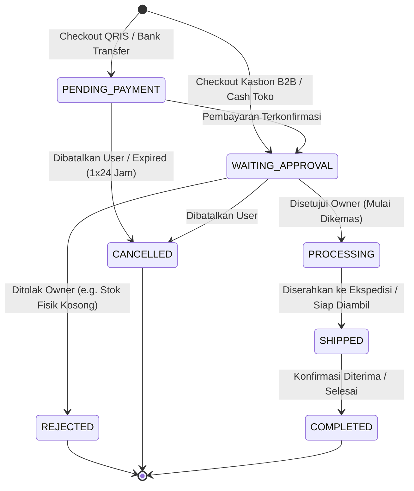

# 📋 Spesifikasi Backend: API Pesanan Pengguna (Profile Orders & Order Management)

> Dokumen spesifikasi teknis RESTful API, skema basis data, dan aturan bisnis untuk modul **Riwayat Pesanan Pelanggan (Profile Orders)** pada platform e-commerce B2B **TIJARAH (BC HNI 3 Bukittinggi)**.

---

## 1. Ringkasan & Aturan Bisnis (Business Rules)

1. **Autentikasi & Otorisasi**:
   - Seluruh endpoint pesanan pengguna wajib diproteksi menggunakan **JWT Bearer Token** (`Authorization: Bearer <token>`).
   - Pengguna hanya berhak mengakses dan memanipulasi pesanan miliknya sendiri (`order.userId === authenticatedUser.id`).
2. **Dual-Pricing & Poin TP HSIS**:
   - Setiap item pesanan menyimpan snapshot harga saat transaksi dibuat (`unitPrice`) dan status apakah pengguna berstatus Agen HNI (`isAgentPriceApplied: true/false`).
   - Jika pengguna adalah agen HNI terverifikasi, perolehan **Poin TP (Target Point)** wajib dihitung dan dicatat per item serta total per pesanan.
3. **Sinkronisasi HSIS (Halal Network International System)**:
   - Setiap pesanan agen HNI memiliki lifecycle posting ke server HSIS (`hsisPostingStatus`: `PENDING` -> `PROCESSING` -> `POSTED` / `HOLD`).
   - Saat berhasil di-input oleh admin toko BC 3 Bukittinggi, nomor nota resmi HSIS (`hsisReceiptNo`) dicatat pada pesanan.
4. **Metode Pembayaran Kasbon B2B (Tempo H+14)**:
   - Jika pembayaran menggunakan `KASBON_B2B`:
     - Plafon kasbon pengguna dipotong sesuai `totalAmount`.
     - Status pembayaran beralih menjadi `TEMPO_ACTIVE` dengan tanggal jatuh tempo `dueDate = createdAt + 14 hari`.
     - Jika pesanan dibatalkan (`CANCELLED`) atau ditolak oleh owner (`REJECTED`), plafon kasbon pengguna wajib dipulihkan kembali secara otomatis via ledger transaksi kredit.
5. **Aksi Pembatalan Pesanan oleh Pengguna**:
   - Pengguna hanya diperbolehkan membatalkan pesanan jika statusnya masih **`PENDING_PAYMENT`** atau **`WAITING_APPROVAL`**.
   - Pesanan yang sudah berstatus `PROCESSING`, `SHIPPED`, atau `COMPLETED` tidak dapat dibatalkan langsung oleh pembeli (harus melalui admin toko).

---

## 2. State Machine & Status Pesanan



### Tabel Status Pesanan (`OrderStatus`)
| Status Code | Label ID | Label EN | Deskripsi | Aksi User yang Diizinkan |
|---|---|---|---|---|
| `PENDING_PAYMENT` | Menunggu Pembayaran | Pending Payment | Menunggu pembayaran via QRIS / VA Transfer. | Bayar Sekarang, Batalkan Pesanan, Lihat Faktur |
| `WAITING_APPROVAL` | Menunggu Verifikasi | Waiting Approval | Menunggu verifikasi fisik ketersediaan barang oleh Admin/Owner. | Batalkan Pesanan, Hubungi Toko, Lihat Faktur |
| `PROCESSING` | Sedang Dikemas | Packing / Processing | Pesanan disetujui toko dan sedang disiapkan/dipacking di gudang BC 3 Bukittinggi. | Hubungi Toko, Lihat Faktur |
| `SHIPPED` | Sedang Dikirim | Shipped / Out for Delivery | Paket telah diserahkan ke kurir atau siap diambil di outlet. | Lacak Pengiriman, Konfirmasi Diterima, Hubungi Toko |
| `COMPLETED` | Selesai | Completed | Paket telah diterima oleh pelanggan atau selesai diambil. | Beli Lagi, Cetak Faktur |
| `REJECTED` | Ditolak Toko | Rejected by Store | Ditolak oleh Owner (misal: stok kosong). Menampilkan alasan penolakan. | Lihat Alasan, Hubungi Toko |
| `CANCELLED` | Dibatalkan | Cancelled | Dibatalkan oleh pelanggan atau kedaluwarsa. | Beli Lagi, Lihat Faktur |

---

## 3. Daftar Endpoint API yang Diminta

| Method | Endpoint | Deskripsi |
|---|---|---|
| `GET` | `/api/v1/user/orders` | Mengambil daftar riwayat pesanan pengguna (mendukung pagination, filter status tab, & pencarian). |
| `GET` | `/api/v1/user/orders/status-counts` | Mengambil ringkasan jumlah pesanan per status untuk badge tab di UI. |
| `GET` | `/api/v1/user/orders/:id` | Mengambil detail lengkap satu pesanan untuk tampilan Resi / Faktur / Modal. |
| `POST` | `/api/v1/user/orders/:id/cancel` | Membatalkan pesanan yang masih menunggu pembayaran / persetujuan. |
| `POST` | `/api/v1/user/orders/:id/confirm-delivered` | Mengonfirmasi bahwa pesanan yang dikirim telah sampai/diterima pembeli. |

---

## 4. Spesifikasi Kontrak Request & Response

### 4.1. `GET /api/v1/user/orders`
> Mengambil daftar riwayat pesanan dengan pagination dan filter status tab.

#### Headers:
```http
Authorization: Bearer <JWT_ACCESS_TOKEN>
Content-Type: application/json
```

#### Query Parameters:
| Parameter | Tipe | Default | Wajib? | Deskripsi |
|---|---|---|---|---|
| `page` | `integer` | `1` | Tidak | Nomor halaman aktif. |
| `limit` | `integer` | `10` | Tidak | Jumlah data per halaman. |
| `status` | `string` | `ALL` | Tidak | Filter status pesanan (`ALL`, `PENDING_PAYMENT`, `WAITING_APPROVAL`, `PROCESSING`, `SHIPPED`, `COMPLETED`, `REJECTED`, `CANCELLED`). |
| `paymentMethod` | `string` | - | Tidak | Filter metode pembayaran (`KASBON_B2B`, `QRIS`, `BANK_TRANSFER`, `CASH`). |
| `search` | `string` | - | Tidak | Pencarian nomor invoice (`orderNumber`) atau nama produk. |
| `startDate` | `string` | - | Tidak | Format `YYYY-MM-DD`. |
| `endDate` | `string` | - | Tidak | Format `YYYY-MM-DD`. |

#### Contoh Request:
```http
GET /api/v1/user/orders?page=1&limit=5&status=ALL HTTP/1.1
Host: api.tijarah.id
Authorization: Bearer eyJhbGciOi...
```

#### Contoh Response Sukses (`200 OK`):
```json
{
  "success": true,
  "message": "Daftar pesanan berhasil diambil",
  "data": [
    {
      "id": "ord_88294711",
      "orderNumber": "INV/2026/09/BC3-0042",
      "createdAt": "2026-09-19T10:30:00.000Z",
      "status": "PROCESSING",
      "paymentMethod": "KASBON_B2B",
      "paymentStatus": "TEMPO_ACTIVE",
      "dueDate": "2026-10-03T10:30:00.000Z",
      "hsisPostingStatus": "PROCESSING",
      "hsisReceiptNo": null,
      "shippingType": "DELIVERY",
      "shippingCourier": "L300 Payakumbuh - Bukittinggi",
      "trackingNumber": "L300-PYK-042",
      "totalAmount": 750000,
      "totalPoints": 180,
      "itemsCount": 3,
      "previewItems": [
        {
          "id": "item_1",
          "productId": "prod_01",
          "productName": "Minyak Herba Sinergi (MHS 100ml)",
          "productImageUrl": "https://cdn.tijarah.id/products/mhs-100ml.png",
          "qty": 5,
          "unitPrice": 45000,
          "tpPoints": 10,
          "totalPrice": 225000
        },
        {
          "id": "item_2",
          "productId": "prod_02",
          "productName": "Sari Kurma Healthy Dates",
          "productImageUrl": "https://cdn.tijarah.id/products/sari-kurma.png",
          "qty": 3,
          "unitPrice": 50000,
          "tpPoints": 12,
          "totalPrice": 150000
        }
      ]
    },
    {
      "id": "ord_88294705",
      "orderNumber": "INV/2026/09/BC3-0012",
      "createdAt": "2026-09-10T14:15:00.000Z",
      "status": "COMPLETED",
      "paymentMethod": "QRIS",
      "paymentStatus": "PAID",
      "dueDate": null,
      "hsisPostingStatus": "POSTED",
      "hsisReceiptNo": "HSIS-BKT3-998811",
      "shippingType": "PICKUP",
      "shippingCourier": "Ambil Mandiri di Outlet BC3",
      "trackingNumber": null,
      "totalAmount": 1420000,
      "totalPoints": 340,
      "itemsCount": 2,
      "previewItems": [
        {
          "id": "item_3",
          "productId": "prod_04",
          "productName": "Kopi HNI 7 Elemen (Sevel)",
          "productImageUrl": "https://cdn.tijarah.id/products/kopi-sevel.png",
          "qty": 6,
          "unitPrice": 90000,
          "tpPoints": 25,
          "totalPrice": 540000
        }
      ]
    }
  ],
  "meta": {
    "page": 1,
    "limit": 5,
    "totalItems": 18,
    "totalPages": 4,
    "countsPerStatus": {
      "ALL": 18,
      "PENDING_PAYMENT": 2,
      "WAITING_APPROVAL": 1,
      "PROCESSING": 3,
      "SHIPPED": 2,
      "COMPLETED": 9,
      "REJECTED": 1,
      "CANCELLED": 0
    }
  }
}
```

---

### 4.2. `GET /api/v1/user/orders/status-counts`
> Endpoint ringan untuk memuat total jumlah pesanan per status (digunakan untuk menampilkan counter pada tab filter secara cepat).

#### Contoh Response (`200 OK`):
```json
{
  "success": true,
  "data": {
    "ALL": 18,
    "PENDING_PAYMENT": 2,
    "WAITING_APPROVAL": 1,
    "PROCESSING": 3,
    "SHIPPED": 2,
    "COMPLETED": 9,
    "REJECTED": 1,
    "CANCELLED": 0
  }
}
```

---

### 4.3. `GET /api/v1/user/orders/:id`
> Mengambil rincian pesanan secara mendalam untuk modal Faktur / Resi / Halaman Detail.

#### Path Parameter:
- `id`: UUID atau ID Pesanan (`string`).

#### Contoh Response Sukses (`200 OK`):
```json
{
  "success": true,
  "message": "Detail pesanan berhasil diambil",
  "data": {
    "id": "ord_88294711",
    "orderNumber": "INV/2026/09/BC3-0042",
    "createdAt": "2026-09-19T10:30:00.000Z",
    "updatedAt": "2026-09-19T11:15:00.000Z",
    "status": "PROCESSING",
    "rejectionReason": null,

    "customer": {
      "userId": "usr_9912",
      "fullName": "Ahmad Fauzi, S.Farm",
      "email": "ahmad.fauzi@example.com",
      "phoneNumber": "081234567890",
      "hniMemberId": "03819284",
      "hniMemberName": "AHMAD FAUZI",
      "isAgentPriceApplied": true
    },

    "shipping": {
      "type": "DELIVERY",
      "recipientName": "Ahmad Fauzi",
      "recipientPhone": "081234567890",
      "destinationAddress": "Jl. Sudirman No. 45, RT 02 / RW 03, Guguk Panjang, Kota Bukittinggi, Sumatera Barat 26115",
      "courierName": "L300 Antar Kota (Bukittinggi - Payakumbuh)",
      "trackingNumber": "L300-PYK-042",
      "shippingCost": 25000,
      "notes": "Tolong titipkan di pos satpam jika tidak ada orang di rumah."
    },

    "payment": {
      "method": "KASBON_B2B",
      "status": "TEMPO_ACTIVE",
      "paidAt": null,
      "dueDate": "2026-10-03T10:30:00.000Z",
      "vaNumber": null,
      "qrisPayload": null,
      "creditProfileId": "cred_00192"
    },

    "hsisIntegration": {
      "status": "PROCESSING",
      "receiptNo": null,
      "postedAt": null,
      "totalTpPoints": 180
    },

    "items": [
      {
        "id": "item_1",
        "productId": "prod_01",
        "sku": "HNI-MHS-100",
        "productName": "Minyak Herba Sinergi (MHS 100ml)",
        "productImageUrl": "https://cdn.tijarah.id/products/mhs-100ml.png",
        "qty": 5,
        "normalPrice": 50000,
        "unitPrice": 45000,
        "tpPoints": 10,
        "totalPrice": 225000,
        "totalPoints": 50
      },
      {
        "id": "item_2",
        "productId": "prod_02",
        "sku": "HNI-SK-DATES",
        "productName": "Sari Kurma Healthy Dates",
        "productImageUrl": "https://cdn.tijarah.id/products/sari-kurma.png",
        "qty": 3,
        "normalPrice": 55000,
        "unitPrice": 50000,
        "tpPoints": 12,
        "totalPrice": 150000,
        "totalPoints": 36
      },
      {
        "id": "item_3",
        "productId": "prod_03",
        "sku": "HNI-EGM-250",
        "productName": "Etta Goat Milk HNI",
        "productImageUrl": "https://cdn.tijarah.id/products/egm-goat-milk.png",
        "qty": 5,
        "normalPrice": 85000,
        "unitPrice": 75000,
        "tpPoints": 20,
        "totalPrice": 375000,
        "totalPoints": 100
      }
    ],

    "summary": {
      "subtotal": 750000,
      "shippingCost": 25000,
      "voucherCode": "DISKONONGKIR25",
      "voucherDiscount": 25000,
      "totalAmount": 750000,
      "totalTpPoints": 180
    },

    "timeline": [
      {
        "status": "WAITING_APPROVAL",
        "title": "Pesanan Dibuat",
        "description": "Pesanan tempo berhasil dibuat dengan metode Kasbon B2B (H+14). Menunggu persetujuan fisik stok oleh Toko BC3.",
        "timestamp": "2026-09-19T10:30:00.000Z"
      },
      {
        "status": "PROCESSING",
        "title": "Disetujui Toko & Sedang Dikemas",
        "description": "Owner menyetujui pesanan. Stok fisik tersedia dan paket sedang dikemas.",
        "timestamp": "2026-09-19T11:15:00.000Z"
      }
    ]
  }
}
```

---

### 4.4. `POST /api/v1/user/orders/:id/cancel`
> Membatalkan pesanan yang belum diproses oleh toko (`PENDING_PAYMENT` atau `WAITING_APPROVAL`).

#### Request Body:
```json
{
  "reason": "Salah memilih alamat tujuan pengiriman"
}
```

#### Contoh Response Sukses (`200 OK`):
```json
{
  "success": true,
  "message": "Pesanan berhasil dibatalkan",
  "data": {
    "id": "ord_88294711",
    "orderNumber": "INV/2026/09/BC3-0042",
    "status": "CANCELLED",
    "cancelledAt": "2026-09-19T10:45:00.000Z",
    "cancellationReason": "Salah memilih alamat tujuan pengiriman",
    "creditRestored": true,
    "restoredAmount": 750000
  }
}
```

#### Response Error (`400 Bad Request`):
```json
{
  "success": false,
  "statusCode": 400,
  "message": "Pesanan tidak dapat dibatalkan karena sudah dalam status PENGEMASAN / PENGIRIMAN. Silakan hubungi admin toko."
}
```

---

### 4.5. `POST /api/v1/user/orders/:id/confirm-delivered`
> Konfirmasi oleh pelanggan bahwa barang kiriman telah diterima dengan baik.

#### Contoh Response Sukses (`200 OK`):
```json
{
  "success": true,
  "message": "Pesanan telah dikonfirmasi selesai",
  "data": {
    "id": "ord_88294711",
    "orderNumber": "INV/2026/09/BC3-0042",
    "status": "COMPLETED",
    "completedAt": "2026-09-22T15:20:00.000Z"
  }
}
```

---

## 5. Referensi Skema Prisma (Database Architecture)

```prisma
enum OrderStatus {
  PENDING_PAYMENT
  WAITING_APPROVAL
  PROCESSING
  SHIPPED
  COMPLETED
  REJECTED
  CANCELLED
}

enum PaymentMethod {
  KASBON_B2B
  QRIS
  BANK_TRANSFER
  CASH
}

enum PaymentStatus {
  UNPAID
  PAID
  TEMPO_ACTIVE
  REFUNDED
}

enum HsisPostingStatus {
  PENDING
  PROCESSING
  POSTED
  HOLD
  FAILED
}

enum ShippingType {
  DELIVERY
  PICKUP
}

model Order {
  id                  String             @id @default(uuid())
  orderNumber         String             @unique // e.g. INV/2026/09/BC3-0042
  userId              String
  user                User               @relation(fields: [userId], references: [id])
  
  // Status Pesanan
  status              OrderStatus        @default(PENDING_PAYMENT)
  rejectionReason     String?
  cancellationReason  String?
  
  // Pricing & Member
  isAgentPriceApplied Boolean            @default(false)
  hniMemberIdSnapshot String?
  subtotal            Decimal            @db.Decimal(12, 2)
  shippingCost        Decimal            @default(0) @db.Decimal(12, 2)
  discountAmount      Decimal            @default(0) @db.Decimal(12, 2)
  totalAmount         Decimal            @db.Decimal(12, 2)
  totalTpPoints       Int                @default(0)
  
  // Pembayaran
  paymentMethod       PaymentMethod
  paymentStatus       PaymentStatus      @default(UNPAID)
  paidAt              DateTime?
  dueDate             DateTime?          // H+14 untuk KASBON_B2B
  vaNumber            String?
  qrisPayload         String?
  creditProfileId     String?            // Jika KASBON_B2B
  
  // Pengiriman
  shippingType        ShippingType       @default(DELIVERY)
  recipientName       String
  recipientPhone      String
  destinationAddress  String             @db.Text
  shippingCourier     String?            // J&T, L300, Ambil di Toko
  trackingNumber      String?
  notes               String?            @db.Text
  
  // HSIS Sync
  hsisPostingStatus   HsisPostingStatus  @default(PENDING)
  hsisReceiptNo       String?            // Nomor Nota Resmi HSIS
  hsisPostedAt        DateTime?
  
  // Items & Timeline
  items               OrderItem[]
  timeline            OrderTimeline[]
  
  createdAt           DateTime           @default(now())
  updatedAt           DateTime           @updatedAt

  @@index([userId, status])
  @@index([orderNumber])
  @@index([createdAt])
}

model OrderItem {
  id              String   @id @default(uuid())
  orderId         String
  order           Order    @relation(fields: [orderId], references: [id], onDelete: Cascade)
  productId       String
  sku             String?
  productName     String
  productImageUrl String?
  qty             Int
  normalPrice     Decimal  @db.Decimal(12, 2)
  unitPrice       Decimal  @db.Decimal(12, 2)
  tpPoints        Int      @default(0)
  totalPrice      Decimal  @db.Decimal(12, 2)
  totalPoints     Int      @default(0)
}

model OrderTimeline {
  id          String      @id @default(uuid())
  orderId     String
  order       Order       @relation(fields: [orderId], references: [id], onDelete: Cascade)
  status      OrderStatus
  title       String
  description String      @db.Text
  createdAt   DateTime    @default(now())
}
```

---

## 6. Standar Error Responses

| HTTP Code | Error Key | Keterangan |
|---|---|---|
| `401 Unauthorized` | `UNAUTHORIZED` | Token JWT tidak disertakan atau telah kedaluwarsa. |
| `403 Forbidden` | `FORBIDDEN_RESOURCE` | Pengguna mencoba mengakses atau membatalkan pesanan milik pengguna lain. |
| `404 Not Found` | `ORDER_NOT_FOUND` | ID pesanan tidak ditemukan di basis data. |
| `400 Bad Request` | `INVALID_CANCELLATION_STATE` | Pesanan tidak bisa dibatalkan karena barang sudah dipacking/dikirim. |
| `500 Internal Error`| `INTERNAL_SERVER_ERROR` | Kesalahan sistem backend saat memproses data. |

---

## 7. Catatan Integrasi untuk Frontend (FE Checklist)

1. Frontend telah menyiapkan hook `@tanstack/react-query` di [useOrders.ts](file:///d:/Developer/Tijarah/front-end/modules/profile/hooks/useOrders.ts) yang mengonsumsi endpoint `GET /api/v1/user/orders`.
2. UI [OrdersPanel.tsx](file:///d:/Developer/Tijarah/front-end/modules/profile/components/organism/panels/OrdersPanel.tsx) telah memiliki:
   - Tab filter status dinamis (`ALL`, `PENDING_PAYMENT`, `PROCESSING`, `SHIPPED`, `COMPLETED`, `REJECTED`, `CANCELLED`).
   - Modal faktur pembelian detail [OrderReceiptModal.tsx](file:///d:/Developer/Tijarah/front-end/modules/profile/components/molecules/OrderReceiptModal.tsx).
   - Indikator status posting HSIS (`hsisPostingStatus`) dan nota HSIS.
   - Tombol pembatalan dan tombol cetak/faktur resi resmi.
3. Backend dapat langsung menggunakan response JSON di atas agar integrasi berjalan *plug-and-play* tanpa perubahan kontrak tipe data di Frontend.
