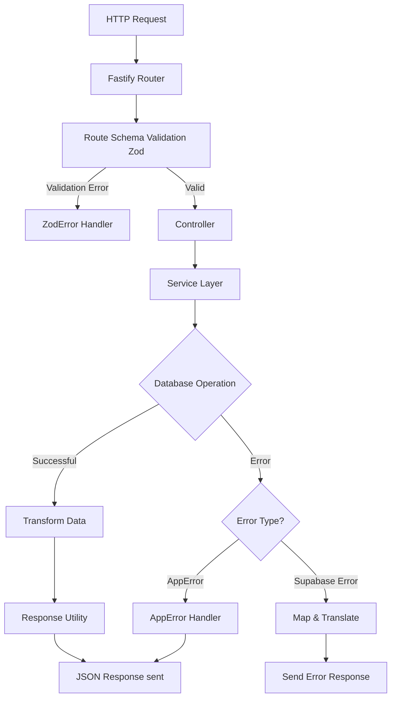

# Backend Architecture - Tijarah API

## Pengenalan

Backend Tijarah menggunakan **Fastify v5** dengan **clean architecture pattern** yang modular dan scalable. Sistem ini terdiri dari layered architecture: Client → Routes → Controller → Service → Database (ORM) + Auth Service.

---

## 1. Tech Stack

### 1.1 Framework & Core

| Technology | Version | Used For |
|------------|---------|----------|
| Node.js | v22+ | Runtime environment |
| Fastify | v5.x | Web framework |
| TypeScript | v5.6+ | Type safety |
| Bun | Latest | Package installer & runtime |

### 1.2 Database & ORM

| Technology | Version | Used For |
|------------|---------|----------|
| PostgreSQL | Latest | Database |
| Prisma ORM | v8.x | ORM & schema management |
| Prisma Client | v8.x | Database client generation |

### 1.3 Validation & Security

| Technology | Version | Used For |
|------------|---------|----------|
| Zod | v4.x | Runtime validation |
| Fastify-Type-Provider-Zod | v7.x | Zod integration with Fastify |
| JWT | latest | Internal token authentication |
| @supabase/server | v1.6+ | Supabase Auth integration |

### 1.4 Security & Logging

| Technology | Version | Used For |
|------------|---------|----------|
| @fastify/cors | v11.x | CORS handling |
| @fastify/helmet | v13.x | HTTP security headers |
| @fastify/rate-limit | v11.x | Rate limiting |
| Pino | v10.x | Structured logging |

### 1.5 Bi-directional Authentication

| Technology | Role |
|------------|------|
| Supabase Auth | User provision & auth flow (email/OTP/Google) |
| Internal JWT | Session token untuk validasi otomatis anti-claim token |
| bcrypt | Password hashing |

---

## 2. Project Structure

```
back-end/
├── src/
│   ├── config/                    # Configuration files
│   │   ├── env.ts                # Environment variables validation
│   │   ├── cors.ts              # CORS options
│   │   ├── rate-limit.ts        # Rate limiting config
│   │   ├── pino.ts              # Logger setup
│   │   ├── axios.ts             # Axios client config
│   │   └── ...
│   │
│   ├── i18n/                     # Internationalization
│   │   ├── index.ts
│   │   └── locales/
│   │       ├── en.ts
│   │       └── id.ts
│   │
│   ├── modules/                  # Feature modules (Main Layer)
│   │   ├── auth/                # Authentication
│   │   │   ├── auth.controller.ts
│   │   │   ├── auth.service.ts
│   │   │   ├── auth.routes.ts
│   │   │   ├── auth.schema.ts
│   │   │   └── auth.type.ts
│   │   │
│   │   ├── addresses/           # Address management
│   │   │   ├── address.controller.ts
│   │   │   ├── address.service.ts
│   │   │   ├── address.routes.ts
│   │   │   ├── address.schema.ts
│   │   │   └── address.type.ts
│   │   │
│   │   ├── checkout/            # Checkout process
│   │   │   ├── checkout.controller.ts
│   │   │   ├── checkout.service.ts
│   │   │   ├── checkout.routes.ts
│   │   │   ├── checkout.schema.ts
│   │   │   └── checkout.type.ts
│   │   │
│   │   ├── credit/              # Credit wallet
│   │   │   ├── credit.controller.ts
│   │   │   ├── credit.service.ts
│   │   │   ├── credit.routes.ts
│   │   │   ├── credit.schema.ts
│   │   │   └── credit.type.ts
│   │   │
│   │   └── notifications/       # Notifications
│   │       ├── notifications.controller.ts
│   │       ├── notifications.service.ts
│   │       ├── notifications.routes.ts
│   │       └── notifications.schema.ts
│   │
│   ├── plugins/                 # Shared plugins
│   │   ├── db.ts               # Prisma DB connection
│   │   └── supabase.ts         # Supabase client
│   │
│   ├── routes/                  # Global routes (entry point)
│   │   └── index.ts            # Route registration
│   │
│   ├── schemas/                 # Shared schemas
│   │   └── common.schema.ts    # Common validation patterns
│   │
│   ├── utils/                   # Utility functions
│   │   ├── AppError.ts         # Custom error class
│   │   └── response.ts         # Response formatters
│   │
│   ├── prisma/                  # Prisma-related
│   │   ├── db.ts               # Prisma client instance
│   │   ├── seed.ts             # Seed data for development
│   │   └── schema.prisma       # Database schema (auto-generated)
│   │
│   ├── views/                   # EJS templates (optional)
│   │   └── index.ejs
│   │
│   ├── app.ts                   # Fastify app initialization
│   └── index.ts                # Entry point
│
├── migrations/                  # Prisma migrations (auto-managed)
├── prisma-8.md                 # Prisma upgrade guide
├── prisma.config.ts            # Prisma configuration
├── .env.example                # Environment variables template
└── package.json
```

---

## 3. Module Structure Pattern

### 3.1 Standard Module Pattern

Setiap module memiliki struktur yang konsisten:

```
src/modules/{module_name}/
├── {module_name}.controller.ts    # Controller layer
├── {module_name}.service.ts        # Service layer (business logic)
├── {module_name}.routes.ts         # Route definitions
├── {module_name}.schema.ts         # Zod validation schemas
├── {module_name}.type.ts           # TypeScript types (optional)
└── {module_name}.prisma           # Local model references (optional)
```

### 3.2 Layer Responsibility

| Layer | Responsibility |
|-------|----------------|
| **Routes** | HTTP method/endpoint mapping, request routing |
| **Schema** | Request validation, TypeScript type inference |
| **Controller** | HTTP request parsing, response formatting, route handler |
| **Service** | Business logic, database operations, state management |

**Flow:** `HTTP Request → Route → Controller → Service → Database`

---

## 4. Database Schema Pattern (Prisma)

### 4.1 Basic Model

```prisma
model User {
  id          String   @id @default(uuid())
  email       String   @unique
  fullName    String
  phoneNumber String?
  passwordHash String
  isDeleted   Boolean  @default(false)

  createdAt   DateTime @default(now())
  updatedAt   DateTime @updatedAt

  addresses   Address[]
  orders      Order[]
  wallet      Wallet?
}
```

### 4.2 Relations

```prisma
model Order {
  id          String        @id @default(uuid())
  userId      String
  user        User          @relation(fields: [userId], references: [id], onDelete: Cascade)
  total       Float
  status      OrderStatus
  createdAt   DateTime      @default(now())

  items       OrderItem[]
  address     Address?
}

enum OrderStatus {
  PENDING
  COMPLETED
  CANCELLED
  REFUNDED
}
```

### 4.3 Cascade Behavior

```prisma
// ✅ Cascade delete -> jika user dihapus, address & orders ikut terhapus
model User {
  addresses   Address[]
  orders      Order[]
}

// ✅ Optional relations
model Product {
  category    Category?    @relation(fields: [categoryId], references: [id])
  tags        ProductTag[]
}

// ✅ One-to-Many dengan Cascade jika user dihapus
model Wallet {
  userId      String       @unique
  user        User         @relation(fields: [userId], references: [id], onDelete: Cascade)
  transactions Transaction[]
}
```

---

## 5. Authentication Flow

### 5.1 Two-Token Strategy

```
┌─────────────────────────────────────────────────────────┐
│  SUPABASE AUTH                                       │
│   ↓                                                   │
│   Access Token (supabase) ←───────────────────────┐   │
│   Refresh Token (supabase)                       │   │
│                                                   │   │
│   User email, phone, is_verified metadata        │   │
└───────────────────────────────────────────────────┘   │
                         ↓                              │
          ┌───────────────┴───────────────┐           │
          ↓                               ↓           │
  Internal JWT                            Supabase    │
  (userId + email)                       Client SDK   │
                                                  │
└───────────────────────────────────────────────────┘
                    ↓
              API Request Endpoint
                      ↓
              Request Validation
                      ↓
              Business Logic
                      ↓
              Response
```

### 5.2 Authentication Methods

1. **Email/Password**
   - `POST /api/v1/auth/register` - Registrasi user baru
   - `POST /api/v1/auth/login` - Authentication via email/password

2. **OTP Verification**
   - Supabase automatically sends OTP (6-digit) ke email
   - `POST /api/v1/auth/verify-otp` - Verify OTP code
   - `POST /api/v1/auth/resend-otp` - Resend OTP

3. **Google OAuth**
   - `GET /api/v1/auth/google/url` - Get Google OAuth URL
   - `POST /api/v1/auth/sign-in-with-google` - Exchange Google token

4. **Email Change (OTP)**
   - `POST /api/v1/auth/request-email-change` - Request email change
   - `POST /api/v1/auth/verify-email-change` - Verify new email

### 5.3 JWT Secret Configuration

```env
# Environment variables (in .env)
JWT_SECRET=your-super-secret-jwt-key-minimum-32-chars-long
JWT_EXPIRES_IN=1d
FRONTEND_URL=https://your-frontend-url.com
```

**Prerequisites:**
- JWT_SECRET should be minimum 32 characters
- JWT_SECRET harus di-rotate setiap 90 hari

---

## 6. Route Convention

### 6.1 HTTP Methods

| Method | Purpose | Example |
|--------|---------|---------|
| `GET` | Retrieve data / existing resource | `/api/v1/auth/me` |
| `POST` | Create new resource | `/api/v1/auth/register` |
| `PUT` | Update whole resource | `/api/v1/auth/me` |
| `PATCH` | Partial update | `/api/v1/addresses/uuid` |
| `DELETE` | Delete resource | `/api/v1/addresses/uuid` |

### 6.2 RESTful Endpoints Pattern

```typescript
// ✅ Pattern 1: Single resource
GET    /api/v1/auth/me              → Get current user profile
POST   /api/v1/auth/register         → Register new user
GET    /api/v1/auth/google/url      → Get Google OAuth URL
POST   /api/v1/auth/verify-otp      → Verify OTP
PATCH  /api/v1/auth/me              → Update profile
DELETE /api/v1/auth/me              → Deactivate account

// ✅ Pattern 2: Collection resource /belongs_to_user
GET    /api/v1/addresses             → Get user's addresses (pagination)
POST   /api/v1/addresses             → Create new address
GET    /api/v1/addresses/:id         → Get single address
PATCH  /api/v1/addresses/:id         → Update address
DELETE /api/v1/addresses/:id         → Delete address
POST   /api/v1/addresses/:id/set-primary → Set as primary

// ✅ Pattern 3: Action endpoint
GET    /api/v1/payments/:id/capture  → Capture payment
POST   /api/v1/payments/refund/:id   → Refund payment
```

### 6.3 Route Registration Pattern

```typescript
// src/routes/index.ts
import { FastifyInstance } from 'fastify';
import { apiRoutes } from './api.routes';

export async function buildRoutes(app: FastifyInstance) {
  // Register all route modules
  app.register(apiRoutes, {
    prefix: '/api/v1'
  });
}
```

```typescript
// src/routes/api.routes.ts
import { FastifyInstance } from 'fastify';
import { authRoutes } from '../modules/auth/auth.routes';
import { addressesRoutes } from '../modules/addresses/address.routes';
import { checkoutRoutes } from '../modules/checkout/checkout.routes';
import { creditRoutes } from '../modules/credit/credit.routes';
import { notificationsRoutes } from '../modules/notifications/notifications.routes';

export async function apiRoutes(app: FastifyInstance) {
  app.register(authRoutes);
  app.register(addressesRoutes);
  app.register(checkoutRoutes);
  app.register(creditRoutes);
  app.register(notificationsRoutes);
}
```

---

## 7. Validation Schema Pattern

### 7.1 Shared Schemas

Located in `src/schemas/common.schema.ts`:

```typescript
// Validasi UUID v4 PostgreSQL
export const zUUID = z
  .string()
  .uuid({ message: "Format ID tidak valid (harus UUID)" });

// Validasi angka positif
export const zPositiveInt = z.coerce
  .number()
  .int()
  .min(1, { message: "Minimal bernilai 1" });

// Validasi nomor HP Indonesia
export const zIndonesianPhone = z
  .string()
  .regex(/^(\+62|62|0)8[1-9][0-9]{7,11}$/, {
    message: "Format nomor telepon Indonesia tidak valid",
  });

// Pagination query string
export const paginationQuerySchema = z.object({
  page: z.coerce.number().int().min(1).default(1),
  limit: z.coerce.number().int().min(1).max(100).default(10),
  search: z.string().trim().optional(),
  sort_by: z.string().optional(),
  order: z.enum(["asc", "desc"]).default("desc"),
});
```

### 7.2 Module Schema Pattern

```typescript
// src/modules/auth/auth.schema.ts
import { z } from 'zod';
import { validateSchema } from '../../schemas/common.schema';

// Body validation schemas
export const registerBodySchema = z.object({
  fullName: z.string().min(3, "auth.validation.full_name_min"),
  phoneNumber: z.string().min(10, "auth.validation.phone_min").max(14, "auth.validation.phone_max"),
  password: z.string().min(8, "auth.validation.password_min"),
  email: z.string().email("auth.validation.email_invalid"),
});

export const loginBodySchema = z.object({
  email: z.string().email("auth.validation.email_invalid"),
  password: z.string().min(8, "auth.validation.password_min"),
});

export const googleAuthBodySchema = z.object({
  token: z.string().optional(),
  access_token: z.string().optional(),
  idToken: z.string().optional(),
});

export const verifyOtpBodySchema = z.object({
  email: z.string().email("auth.validation.email_invalid"),
  token: z.string().min(6, "auth.validation.otp_min"),
  type: z.enum(['signup', 'email_change', 'email']).optional().default('signup'),
});

export const resendOtpBodySchema = z.object({
  email: z.string().email("auth.validation.email_invalid"),
  type: z.enum(['signup', 'email_change']).optional().default('signup'),
});

export const authHashBodySchema = z.object({
  accessToken: z.string(),
  refreshToken: z.string(),
});

// Route schemas (wrapped with validateSchema)
export const registerSchema = validateSchema({
  body: registerBodySchema,
});

export const loginSchema = validateSchema({
  body: loginBodySchema,
});
```

### 7.3 Validation Flow

```
HTTP Request → Route (with schema) → Fastify Type Provider (runtime validation) → Invalid → 400+ error (Zod error mapped to error response) → Controller → Service → DB
```

---

## 8. Controller Pattern

### 8.1 Standard Controller Structure

```typescript
import { FastifyRequest, FastifyReply } from 'fastify';
import { responseUtil } from "@/utils/response";
import { AppError } from "@/utils/AppError";
import { serviceInstance } from "./{module}.service";
import { typePayload } from "./{module}.type";
import { getLanguageFromRequest, t } from "@/i18n";

export const {module}Controller = {
  async {actionName}(req: FastifyRequest<{ Body/Params }>, res: FastifyReply) {
    const lang = getLanguageFromRequest(req);
    const userId = getUserIdFromRequest(req);

    try {
      // 1. Parse parameters
      const payload = req.body as typePayload;

      // 2. Call service layer
      const data = await {module}Service.{actionName}(
        { ...payload, userId },
        lang
      );

      // 3. Response
      return responseUtil.created({
        reply: res,
        message: t('{module}.{action}_success', {}, lang),
        data,
      });
    } catch (error: any) {
      if (error instanceof AppError) {
        return res.code(error.statusCode).send({
          status: 'error',
          message: error.message,
          ...(error.details ? { details: error.details } : {})
        });
      }
      throw error;
    }
  },

  async {readOnlyAction}(req: FastifyRequest<{ Params }>, res: FastifyReply) {
    const lang = getLanguageFromRequest(req);
    const { id } = req.params;

    try {
      const data = await {module}Service.{readOnlyAction}(id, lang);

      return responseUtil.success({
        reply: res,
        message: t('{module}.{action}_success', {}, lang),
        data,
      });
    } catch (error: any) {
      if (error instanceof AppError) {
        return res.code(error.statusCode).send({
          status: 'error',
          message: error.message,
          ...(error.details ? { details: error.details } : {})
        });
      }
      throw error;
    }
  }
}
```

### 8.2 Controller Principles

✅ **DO:**
- Request parsing & params extraction
- Language deduction from request
- Call service layer (not DB directly)
- Use `responseUtil` for standardized response
- Catch `AppError` specially, rethrow others
- Use `t()` for i18n error messages
- Type annotate request body/params with TypeScript

❌ **DON'T:**
- Call database directly (use service)
- Perform business logic (use service)
- Throw generic generic `Error` (throw AppError)
- Return raw `res.send()` (use responseUtil)

---

## 9. Service Layer Pattern

### 9.1 Standard Service Structure

```typescript
import { db } from "@/prisma/db";
import { AppError } from "@/utils/AppError";
import { SupportedLanguage, t, translateSupabaseError } from "@/i18n";

export const {module}Service = {
  async {actionName}(params: { data }, lang: SupportedLanguage = 'id') {
    try {
      // 1. Business Logic / Validation
      // Check existing records
      const existing = await db.orm.{table}.where({ id: params.id }).first();
      if (existing) {
        throw new AppError(t('{module}.already_exists', {}, lang), 400);
      }

      // 2. Database Operation
      const data = await db.orm.{table}.create({
        { ...params }
      });

      // 3. Transform/Response
      const { sensitiveField, ...response } = data;
      return {
        ...response,
        // Additional computed fields
        status: 'active'
      };

    } catch (error: any) {
      // Handle known errors (AppError - rethrow)
      if (error instanceof AppError) throw error;

      // Handle Supabase errors
      if (error.message.includes('email_already_exists')) {
        throw new AppError(
          t('{module}.email_already_exists', {}, lang),
          400
        );
      }

      // Unknown errors - log + rethrow as 500
      const message = t('{module}.{action_name}_failed', {}, lang);
      throw new AppError(message, 500, {
        originalError: error.message
      });
    }
  }
}
```

### 9.2 Service Layer Responsibilities

✅ **DO:**
- Business logic isolation
- Database operations via Prisma ORM
- Data transformation/response shaping
- Handling business rules & constraints
- Supabase API calls within service
- Error handling (catch exceptions, map to AppError)
- i18n support via `t()` function

❌ **DON'T:**
- Direct HTTP request/response (use controller)
- Add HTTP-specific code (status codes, headers)
- Perform complex transformations in controller
- Call multiple services in parallel manually (use async/await)

---

## 10. Response Format Standard

### 10.1 Success Response

```typescript
// 200 OK - General success
{
  status: 'success',
  message: 'Operation completed successfully',
  { /* response data */ }
}

// 201 Created - New resource created
{
  status: 'success',
  message: 'User created successfully',
  {
    id: 'uuid-123',
    email: 'user@example.com'
  }
}

// 200 OK - Read operation with data
{
  status: 'success',
  message: 'Addresses retrieved successfully',
  [
    {
      id: 'uuid-1',
      label: 'Home',
      address: 'Jl. Mawar No. 1'
    }
  ]
}
```

### 10.2 Error Response

```typescript
// 400 Bad Request - Validation failed
{
  status: 'error',
  message: 'Email not confirmed',
  errors: [
    {
      field: 'email',
      message: 'common.validation.email_already_exists'
    }
  ]
}

// 401 Unauthorized - Not authenticated
{
  status: 'error',
  message: 'Unauthorized',
  errors: [
    { field: 'id', message: 'Token invalid or expired' }
  ]
}

// 404 Not Found - Resource not found
{
  status: 'error',
  message: 'Address not found'
}

// 403 Forbidden - Permission denied
{
  status: 'error',
  message: 'You do not have permission to access this resource'
}

// 429 Too Many Requests - Rate limit exceeded
{
  status: 'error',
  message: 'Too many requests',
  details: {
    rateLimitExceeded: true,
    retryAfter: 60
  }
}

// 500 Internal Server Error - System error
{
  status: 'error',
  message: 'Internal server error',
  details: {
    error: 'Database connection failed'
  }
}
```

### 10.3 Response Utility Format

Located in `src/utils/response.ts`:

```typescript
export const responseUtil = {
  // 200 OK
  success<T>({ reply, message = 'Success', data }: SuccessResponseParams<T>) {
    return reply.code(200).send({
      status: 'success',
      message,
      ...(data !== undefined && { data }),
    });
  },

  // 201 Created
  created<T>({ reply, message = 'Created successfully', data }: SuccessResponseParams<T>) {
    return reply.code(201).send({
      status: 'success',
      message,
      ...(data !== undefined && { data }),
    });
  },

  // 400 Bad Request
  badRequest(reply: FastifyReply, message = 'Bad Request') {
    return reply.code(400).send({ status: 'error', message });
  },

  // 401 Unauthorized
  unauthorized(reply: FastifyReply, message = 'Unauthorized') {
    return reply.code(401).send({ status: 'error', message });
  },

  // 403 Forbidden
  forbidden(reply: FastifyReply, message = 'Forbidden') {
    return reply.code(403).send({ status: 'error', message });
  },

  // 404 Not Found
  notFound(reply: FastifyReply, message = 'Not Found') {
    return reply.code(404).send({ status: 'error', message });
  },

  // 500 Internal Server Error
  internalServerError(reply: FastifyReply, message = 'Internal Server Error') {
    return reply.code(500).send({ status: 'error', message });
  }
}
```

---

## 11. Error Handling Pattern

### 11.1 AppError Custom Class

Located in `src/utils/AppError.ts`:

```typescript
export class AppError extends Error {
  public statusCode: number;
  public details?: any;

  constructor(message: string, statusCode: number = 400, details?: any) {
    super(message);
    this.statusCode = statusCode;
    this.details = details;
    // 确保 prototype 被正确设置（可选）
    Object.setPrototypeOf(this, new.target.prototype);
    Error.captureStackTrace(this, this.constructor);
  }
}
```

**Usage:**

```typescript
// Throw custom error
throw new AppError('User already exists', 400);

// Throw custom error with details
throw new AppError('Invalid token', 401, {
  hint: 'Please login again'
});

// Throw with Supabase error mapping
const { data, error } = await supabase.auth.getUser(token);
if (error) {
  throw new AppError(
    t('auth.verify_otp_failed', { message: error.message }, lang),
    400,
    { supabaseError: error, code: error.code }
  );
}
```

### 11.2 Error Response Mapping

Located in `src/app.ts` - Global error handler:

```typescript
app.setErrorHandler((error: any, request, reply) => {
  const lang = getLanguageFromRequest(request);

  // Fastify Validation Error (Zod)
  if (error.validation || error.name === 'ZodError') {
    const issues = error.issues || error.validation || [];
    const formattedErrors = Array.isArray(issues)
      ? issues.map((issue: any) => ({
          field: Array.isArray(issue.path) ? issue.path.join('.') : 'unknown',
          message: t(rawMsg, {}, lang),
        }))
      : [];

    return reply.code(400).send({
      status: 'error',
      message: formattedErrors[0]?.message || t('common.bad_request', {}, lang),
      errors: formattedErrors,
    });
  }

  // AppError (Custom error)
  if (error instanceof AppError) {
    return reply.code(error.statusCode).send({
      status: 'error',
      message: error.message,
      ...(error.details ? { details: error.details } : {})
    });
  }

  // Unknown error
  return reply.code(500).send({
    status: 'error',
    message: 'Internal server error'
  });
});
```

---

## 12. Authentication Middleware

### 12.1 JWT Token Validation

Suatu endpoint akan otomatis memverifikasi JWT appToken internal jika:

1. `appToken` di-set di request headers: `Authorization: Bearer <token>`
2. JWT secret valid & tidak expired

**Active endpoints:**
- `/api/v1/auth/me`
- `/api/v1/addresses` (CRUD)
- `/api/v1/credit` (CRUD)
- `/api/v1/checkout` (transaction)

**Manual token verification:**

```typescript
import { db } from "@/prisma/db";
import jwt from 'jsonwebtoken';
import { AppError } from "@/utils/AppError";

export async function getUserFromToken(token: string) {
  try {
    const decoded = jwt.verify(token, env.JWT_SECRET) as {
      userId: string;
      email: string;
      phoneNumber?: string;
    };

    const user = await db.orm.core_auth.User.where({ id: decoded.userId }).first();
    if (!user || user.isDeleted) {
      throw new AppError('User not found', 404);
    }

    return user;
  } catch (error) {
    if (error instanceof jwt.JsonWebTokenError) {
      throw new AppError('Invalid token', 401);
    }
    throw error;
  }
}
```

---

## 13. Internationalization (i18n)

### 13.1 Language Support

Currently supports:
- `id` (Indonesian) - Default
- `en` (English)

### 13.2 Translations Pattern

**Backend (`src/i18n/locales/`):**

```typescript
// src/i18n/locales/id.ts
export const translations = {
  'auth.register_success': 'Pendaftaran berhasil',
  'auth.register_failed': 'Gagal mendaftar',
  'auth.password_mismatch': 'Password tidak cocok',
  'addresses.get_addresses_success': 'Alamat berhasil diambil',
  'addresses.create_address_success': 'Alamat berhasil dibuat',
  'common.validation.email_invalid': 'Format email tidak valid',
  'common.bad_request': 'Permintaan tidak valid'
};
```

### 13.3 Usage in Code

```typescript
import { t, translateSupabaseError } from '@/i18n';

// Translate message
const message = t('auth.register_success', {}, lang);

// Translate Supabase error
const translatedMsg = translateSupabaseError(error.message, lang);

// Translate nested object (validation messages)
error: z.string().min(3, "auth.validation.full_name_min")
```

---

## 14. Database Query Pattern (Prisma ORM)

### 14.1 Basic Query

```typescript
// ✅ Simple query
const user = await db.orm.core_auth.User.where({ email }).first();

// ✅ Create
const newUser = await db.orm.core_auth.User.create({
  { ... }
});

// ✅ Find by ID
const user = await db.orm.core_auth.User.where({ id }).first();

// ✅ Update (upsert)
const existing = await db.orm.core_auth.User.where({ email }).first();
const user = existing
  ? await db.orm.core_auth.User.update({
      where: { email },
      { ... }
    })
  : await db.orm.core_auth.User.create({
      create: { ... }
    });
```

### 14.2 Relations

```typescript
// ✅ Include related data
const user = await db.orm.core_auth.User.where({ id })
  .include({ addresses: true })
  .first();

// ✅ Filter by relation
const activeUsers = await db.orm.core_auth.User.where({
  isActive: true
}).include({ lastOrder: true }).all();

// ✅ Update through relation
const order = await db.orm.Order.where({ id }).first();
const updated = await db.orm.core_auth.User.update({
  where: { id: order.userId },
  { lastOrder: order }
});
```

### 14.3 Pagination

```typescript
// ✅ Pagination with Prisma ORM
const { results, paginationInfo } = await db.orm.core_auth.User.where(
  { isActive: true },
  {
    skip: (page - 1) * limit,
    take: limit,
    orderBy: { createdAt: 'desc' }
  }
);
```

---

## 15. Code Flow Diagram



---

## 16. Database Migrations

### 16.1 Prisma Migrate Pattern

```bash
# Generate migration from schema changes
bunx prisma migrate dev --name "add_wallet_schema"

# Apply all migrations to production
prisma migrate deploy

# Reset database (development only)
prisma migrate reset --force

# Generate Prisma Client
bunx prisma generate
```

### 16.2 Migration Naming Convention

```
add_wallet_transactions_table
rename_email_field_to_person_email
add_is_verified_to_auth_user
add_primary_address_field
```

---

## 17. Testing (Recommended)

### 17.1 Test Structure

```typescript
// src/modules/auth/auth.service.test.ts
import { describe, it, expect, beforeEach } from 'bun:test';
import { authService } from './auth.service';
import { db } from '@/prisma/db';

describe('AuthService', () => {
  beforeEach(async () => {
    await db.orm.core_auth.User.deleteMany({});
  });

  it('should register new user successfully', async () => {
    const result = await authService.register({
      email: 'test@example.com',
      password: 'password123',
      fullName: 'Test User'
    }, 'id');

    expect(result.email).toBe('test@example.com');
    expect(result.requireOtp).toBe(true);
  });

  it('should throw error if email already exists', async () => {
    await authService.register({
      email: 'test@example.com',
      password: 'password123',
      fullName: 'Test User'
    }, 'id');

    await expect(authService.register({
      email: 'test@example.com',
      password: 'password123',
      fullName: 'Test User 2'
    }, 'id')).rejects.toThrow(/already exists/);
  });
});
```

---

## 18. Deployment Best Practices

### 18.1 Environment Variables

```env
# Required
NODE_ENV=production
DATABASE_URL=postgresql://...
JWT_SECRET=your-super-secret-jwt-key
JWT_EXPIRES_IN=1d
SUPABASE_URL=https://your-project.supabase.co
SUPABASE_ANON_KEY=your-anon-key
SUPABASE_SERVICE_ROLE_KEY=your-service-key

# Optional
PORT=3000
HOST=0.0.0.0
FRONTEND_URL=https://your-frontend.com
LOG_LEVEL=info
```

### 18.2 Production Checklist

- [ ] `NODE_ENV=production`
- [ ] Secure JWT_SECRET (environment variable, not hardcoded)
- [ ] Database connection pool tuning
- [ ] Enable rate limiting (`@fastify/rate-limit`)
- [ ] Security headers (`@fastify/helmet`)
- [ ] Enable CORS with specific origins
- [ ] Enable logging (structured JSON logs)
- [ ] Set up monitoring (health check endpoint)

---

**Last Updated:** 2026-10-15
**Version:** 1.0.0