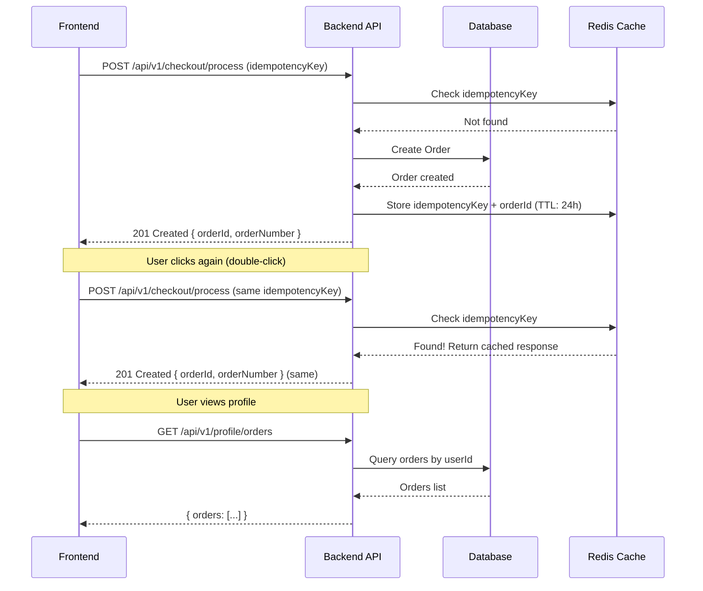
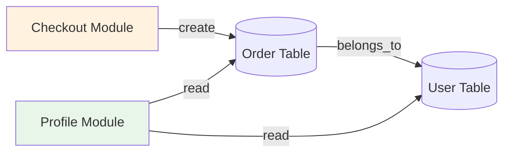

# Checkout-Profile Integration & Idempotent Payment System

## Pengenalan

Dokumentasi ini menjelaskan integrasi modul **Checkout** dan **Profile**, dengan fokus pada:

1. **Order History di Profile** - Pesanan yang dibuat di checkout akan muncul di profile user
2. **Idempotent Payment** - Handling double-click user saat pembayaran (mencegah duplikasi order)
3. **Payment Status Tracking** - Transparansi status pembayaran dari checkout hingga shipment
4. **B2B Credit Integration** - Integrasi kasbon B2B dengan checkout dan profile

---

## 1. Architecture Overview

### 1.1 Data Flow Diagram



### 1.2 Module Dependencies



---

## 2. Database Schema Integration

### 2.1 Order Table (Enhanced)

```prisma
model Order {
  id                    String      @id @default(uuid())
  orderNumber           String      @unique                    // ORD/20261015/BC3-1234
  userId                String
  user                  User        @relation(fields: [userId], references: [id], onDelete: Cascade)
  
  // Items & Pricing
  items                 OrderItem[]
  subtotal              Float                                  // Harga sebelum diskon & ongkir
  shippingCost          Float       @default(0)
  discountAmount        Float       @default(0)
  totalAmount           Float                                  // Harga final
  totalTpPoints         Int         @default(0)               // TP Points untuk agent
  
  // Shipping & Delivery
  shippingType          String      @default("DELIVERY")      // DELIVERY | PICKUP
  shippingAddressText   String?                                // Pickup address or custom text
  shippingCourier       String?                                // JNE, J&T, PICKUP_STORE, etc
  addressId             String?
  address               Address?    @relation(fields: [addressId], references: [id])
  trackingNumber        String?
  
  // Payment & Status
  paymentMethod         String                                 // B2B_CREDIT | QRIS_MOCKUP | BANK_TRANSFER_MOCKUP | CASH_STORE
  paymentStatus         String      @default("UNPAID")        // UNPAID | PAID | TEMPO_ACTIVE | REFUNDED
  orderStatus           String      @default("WAITING_APPROVAL") // WAITING_APPROVAL | PROCESSING | SHIPPED | COMPLETED | REJECTED | CANCELLED
  
  // Kasbon B2B Related
  isAgentPriceApplied   Boolean     @default(false)
  dueDate               DateTime?                              // H+14 untuk kasbon
  voucherCode           String?
  
  // Admin Notes
  notes                 String?
  rejectionReason       String?
  approvedAt            DateTime?
  approvedBy            String?
  rejectedAt            DateTime?
  rejectedBy            String?
  
  // Idempotency
  idempotencyKey        String?     @unique                    // Unique key untuk payment idempotency
  
  // Timestamps
  createdAt             DateTime    @default(now())
  updatedAt             DateTime    @updatedAt
  
  @@index([userId])
  @@index([orderNumber])
  @@index([idempotencyKey])
  @@index([createdAt])
}

model OrderItem {
  id                String      @id @default(uuid())
  orderId           String
  order             Order       @relation(fields: [orderId], references: [id], onDelete: Cascade)
  
  productId         String
  productName       String
  qty               Int
  unitPrice         Float
  tpPoints          Int         @default(0)
  totalPrice        Float                              // unitPrice * qty
  
  createdAt         DateTime    @default(now())
  
  @@index([orderId])
  @@index([productId])
}
```

### 2.2 Idempotency Key Table (Optional)

```prisma
model IdempotencyKey {
  id                  String      @id @default(uuid())
  key                 String      @unique
  endpoint            String                          // POST /api/v1/checkout/process
  userId              String
  
  // Response cached
  statusCode          Int
  responseBody        String      @db.Text            // JSON stringified
  
  // TTL: 24 hours (managed at application level)
  expiresAt           DateTime
  createdAt           DateTime    @default(now())
  
  @@index([key])
  @@index([userId])
  @@index([expiresAt])
}
```

---

## 3. Checkout Module - Idempotent Payment Implementation

### 3.1 Enhanced Schema

File: `src/modules/checkout/checkout.schema.ts`

```typescript
import { z } from 'zod';
import { validateSchema } from '@/schemas/common.schema';

// Add idempotencyKey to processCheckout
export const processCheckoutBodySchema = z.object({
  userId: zUUID.optional(),
  shippingType: z.enum(["DELIVERY", "PICKUP"]).default("DELIVERY"),
  addressId: zUUID.optional(),
  shippingCourier: z.string().optional(),
  shippingCost: z.number().min(0).optional().default(0),
  voucherCode: z.string().optional(),
  paymentMethod: z.enum(["B2B_CREDIT", "QRIS_MOCKUP", "BANK_TRANSFER_MOCKUP", "CASH_STORE"]),
  notes: z.string().optional(),
  items: z.array(checkoutItemSchema).min(1),
  
  // Idempotency key for payment safety
  idempotencyKey: z.string().uuid().optional(),  // Optional but recommended
});

export const processCheckoutSchema = validateSchema({
  body: processCheckoutBodySchema,
  headers: z.object({
    'idempotency-key': z.string().uuid().optional(),  // Alternative: from header
  }).optional(),
});

export type ProcessCheckoutBody = z.infer<typeof processCheckoutBodySchema>;
```

### 3.2 Enhanced Controller

File: `src/modules/checkout/checkout.controller.ts`

```typescript
export const checkoutController = {
  processCheckout: async (
    req: FastifyRequest<{ Body: ProcessCheckoutBody }>,
    res: FastifyReply
  ) => {
    const lang = getLanguageFromRequest(req);
    const userId = req.body.userId || (req as any).user?.id;

    if (!userId) {
      return res.code(400).send({
        status: 'error',
        message: t('profile.user_not_found', {}, lang),
      });
    }

    try {
      // 1. Generate or use provided idempotencyKey
      const idempotencyKey = req.body.idempotencyKey || 
                             (req.headers['idempotency-key'] as string) || 
                             crypto.randomUUID();

      // 2. Check if order already exists with this key
      const existingOrder = await db.orm.orders.Order
        .where({ idempotencyKey })
        .first();

      if (existingOrder) {
        // Return cached response (same order)
        return responseUtil.created({
          reply: res,
          message: t('checkout.process_success', {}, lang),
          data: await checkoutService.getOrderReceipt(existingOrder.id, lang),
        });
      }

      // 3. Process checkout (new order)
      const data = await checkoutService.processCheckout(
        userId,
        { ...req.body, idempotencyKey },
        lang
      );

      return responseUtil.created({
        reply: res,
        message: req.body.paymentMethod === 'B2B_CREDIT'
          ? t('checkout.kasbon_success', {}, lang)
          : t('checkout.process_success', {}, lang),
        data,
      });
    } catch (error: any) {
      if (error instanceof AppError) {
        return res.code(error.statusCode).send({
          status: 'error',
          message: error.message,
          ...(error.details ? { details: error.details } : {})
        });
      }
      throw error;
    }
  }
};
```

### 3.3 Enhanced Service

File: `src/modules/checkout/checkout.service.ts`

```typescript
export const checkoutService = {
  async processCheckout(
    userId: string,
    payload: ProcessCheckoutBody & { idempotencyKey: string },
    lang: SupportedLanguage = 'id'
  ) {
    try {
      // ... existing validation code ...

      // Create Order dengan idempotencyKey
      const order = await db.orm.orders.Order.create({
        orderNumber,
        userId,
        idempotencyKey: payload.idempotencyKey,  // Store idempotency key
        isAgentPriceApplied: isAgent,
        shippingType: payload.shippingType,
        addressId: payload.addressId || undefined,
        shippingAddressText,
        shippingCourier,
        subtotal,
        shippingCost,
        discountAmount,
        voucherCode: payload.voucherCode || undefined,
        totalAmount,
        totalTpPoints,
        paymentMethod: payload.paymentMethod,
        paymentStatus,
        orderStatus,
        dueDate: dueDateIso || undefined,
        notes: payload.notes || undefined,
      });

      // ... rest of implementation ...

      return this.getOrderReceipt(order.id, lang);
    } catch (error: any) {
      if (error instanceof AppError) throw error;
      throw new AppError(
        t('checkout.process_failed', { message: error.message }, lang),
        500
      );
    }
  },

  async simulateMockPayment(orderId: string, lang: SupportedLanguage = 'id') {
    try {
      const order = await db.orm.orders.Order.where({ id: orderId }).first();
      if (!order) {
        throw new AppError(t('checkout.order_not_found', {}, lang), 404);
      }

      // Prevent double payment (idempotency)
      if (order.paymentStatus === "PAID") {
        return this.getOrderReceipt(order.id, lang);
      }

      await db.orm.orders.Order
        .where({ id: order.id })
        .update({
          paymentStatus: "PAID",
          orderStatus: "WAITING_APPROVAL",
        });

      await notificationsService.createNotification({
        userId: order.userId,
        title: "Pembayaran Dikonfirmasi",
        message: `Pembayaran untuk pesanan ${order.orderNumber} telah diterima.`,
        category: "ORDER_STATUS",
        referenceId: order.id,
      });

      return this.getOrderReceipt(order.id, lang);
    } catch (error: any) {
      if (error instanceof AppError) throw error;
      throw new AppError(
        t('checkout.payment_failed', { message: error.message }, lang),
        500
      );
    }
  },
};
```

---

## 4. Profile Module - Order History Integration

### 4.1 New Endpoints

File: `src/modules/profile/profile.routes.ts`

```typescript
export async function profileRoutes(app: FastifyInstance) {
  const server = app.withTypeProvider<ZodTypeProvider>();

  // Get user profile with related data
  server.get('/me', profileSchema.getProfileSchema, profileController.getProfile);

  // Update user profile
  server.patch('/me', profileSchema.updateProfileSchema, profileController.updateProfile);

  // HNI Profile
  server.post('/hni/save', profileSchema.saveHniProfileSchema, profileController.saveHniProfile);
  server.post('/hni/search', profileSchema.searchHniProfileSchema, profileController.searchHniProfile);

  // ✅ NEW: Order History
  server.get('/orders', profileSchema.getOrdersSchema, profileController.getOrders);
  server.get('/orders/:orderId', profileSchema.getOrderDetailSchema, profileController.getOrderDetail);

  // ✅ NEW: Credit Account
  server.get('/credit', profileController.getCreditAccount);
  server.get('/credit/ledger', profileController.getCreditLedger);
}
```

### 4.2 Enhanced Schema

File: `src/modules/profile/profile.schema.ts`

```typescript
export const getOrdersQuerySchema = z.object({
  page: z.coerce.number().int().min(1).default(1),
  limit: z.coerce.number().int().min(1).max(100).default(10),
  status: z.enum([
    'WAITING_APPROVAL',
    'PROCESSING',
    'SHIPPED',
    'COMPLETED',
    'REJECTED',
    'CANCELLED'
  ]).optional(),
  paymentStatus: z.enum(['UNPAID', 'PAID', 'TEMPO_ACTIVE', 'REFUNDED']).optional(),
  sortBy: z.enum(['createdAt', 'totalAmount']).default('createdAt'),
  order: z.enum(['asc', 'desc']).default('desc'),
});

export const getOrdersSchema = validateSchema({
  querystring: getOrdersQuerySchema,
});

export const getOrderDetailParamsSchema = z.object({
  orderId: zUUID,
});

export const getOrderDetailSchema = validateSchema({
  params: getOrderDetailParamsSchema,
});

export type GetOrdersQuery = z.infer<typeof getOrdersQuerySchema>;
export type GetOrderDetailParams = z.infer<typeof getOrderDetailParamsSchema>;
```

### 4.3 Enhanced Controller

File: `src/modules/profile/profile.controller.ts`

```typescript
export const profileController = {
  // ... existing methods ...

  // ✅ NEW: Get orders for user
  getOrders: async (
    req: FastifyRequest<{ Querystring: GetOrdersQuery }>,
    res: FastifyReply
  ) => {
    const lang = getLanguageFromRequest(req);
    const userId = (req as any).user?.id;

    if (!userId) {
      return res.code(401).send({
        status: 'error',
        message: t('profile.user_not_found', {}, lang),
      });
    }

    try {
      const data = await profileService.getOrders(userId, req.query, lang);

      return responseUtil.success({
        reply: res,
        message: t('profile.orders_success', {}, lang),
        data,
      });
    } catch (error: any) {
      if (error instanceof AppError) {
        return res.code(error.statusCode).send({
          status: 'error',
          message: error.message,
          ...(error.details ? { details: error.details } : {})
        });
      }
      throw error;
    }
  },

  // ✅ NEW: Get order detail with items
  getOrderDetail: async (
    req: FastifyRequest<{ Params: GetOrderDetailParams }>,
    res: FastifyReply
  ) => {
    const lang = getLanguageFromRequest(req);
    const userId = (req as any).user?.id;

    if (!userId) {
      return res.code(401).send({
        status: 'error',
        message: t('profile.user_not_found', {}, lang),
      });
    }

    try {
      const data = await profileService.getOrderDetail(
        userId,
        req.params.orderId,
        lang
      );

      return responseUtil.success({
        reply: res,
        message: t('profile.order_detail_success', {}, lang),
        data,
      });
    } catch (error: any) {
      if (error instanceof AppError) {
        return res.code(error.statusCode).send({
          status: 'error',
          message: error.message,
          ...(error.details ? { details: error.details } : {})
        });
      }
      throw error;
    }
  },

  // ✅ NEW: Get credit account info
  getCreditAccount: async (
    req: FastifyRequest,
    res: FastifyReply
  ) => {
    const lang = getLanguageFromRequest(req);
    const userId = (req as any).user?.id;

    if (!userId) {
      return res.code(401).send({
        status: 'error',
        message: t('profile.user_not_found', {}, lang),
      });
    }

    try {
      const data = await creditService.getCreditAccount(userId, lang);

      return responseUtil.success({
        reply: res,
        message: t('credit.get_account_success', {}, lang),
        data,
      });
    } catch (error: any) {
      if (error instanceof AppError) {
        return res.code(error.statusCode).send({
          status: 'error',
          message: error.message,
        });
      }
      throw error;
    }
  },

  // ✅ NEW: Get credit ledger (transaction history)
  getCreditLedger: async (
    req: FastifyRequest,
    res: FastifyReply
  ) => {
    const lang = getLanguageFromRequest(req);
    const userId = (req as any).user?.id;

    if (!userId) {
      return res.code(401).send({
        status: 'error',
        message: t('profile.user_not_found', {}, lang),
      });
    }

    try {
      const data = await creditService.getCreditLedger(userId, lang);

      return responseUtil.success({
        reply: res,
        message: t('credit.get_ledger_success', {}, lang),
        data,
      });
    } catch (error: any) {
      if (error instanceof AppError) {
        return res.code(error.statusCode).send({
          status: 'error',
          message: error.message,
        });
      }
      throw error;
    }
  },
};
```

### 4.4 Enhanced Service

File: `src/modules/profile/profile.service.ts`

```typescript
export const profileService = {
  // ... existing methods ...

  // ✅ NEW: Get paginated orders for user
  async getOrders(
    userId: string,
    query: GetOrdersQuery,
    lang: SupportedLanguage = 'id'
  ) {
    try {
      const skip = (query.page - 1) * query.limit;
      const take = query.limit;

      // Build where clause
      const whereClause: any = { userId };
      if (query.status) whereClause.orderStatus = query.status;
      if (query.paymentStatus) whereClause.paymentStatus = query.paymentStatus;

      // Query orders
      const orders = await db.orm.orders.Order
        .where(whereClause)
        .orderBy({ [query.sortBy]: query.order })
        .limit(take)
        .skip(skip)
        .all();

      // Get total count
      const totalItems = await db.orm.orders.Order
        .where(whereClause)
        .count();

      // Get items for each order
      const ordersWithItems = await Promise.all(
        orders.map(async (order) => {
          const items = await db.orm.orders.OrderItem
            .where({ orderId: order.id })
            .all();

          return {
            ...order,
            items,
            itemsCount: items.length,
          };
        })
      );

      return {
        orders: ordersWithItems,
        pagination: {
          page: query.page,
          limit: query.limit,
          totalItems,
          totalPages: Math.ceil(totalItems / query.limit),
        },
      };
    } catch (error: any) {
      if (error instanceof AppError) throw error;
      throw new AppError(
        t('profile.get_orders_failed', { message: error.message }, lang),
        500
      );
    }
  },

  // ✅ NEW: Get detailed order info with authorization check
  async getOrderDetail(
    userId: string,
    orderId: string,
    lang: SupportedLanguage = 'id'
  ) {
    try {
      const order = await db.orm.orders.Order.where({ id: orderId }).first();

      if (!order) {
        throw new AppError(t('checkout.order_not_found', {}, lang), 404);
      }

      // Authorization: only order owner can view
      if (order.userId !== userId) {
        throw new AppError(t('common.forbidden', {}, lang), 403);
      }

      const items = await db.orm.orders.OrderItem
        .where({ orderId: order.id })
        .all();

      const user = await db.orm.core_auth.User
        .where({ id: order.userId })
        .include('hniProfile')
        .first();

      return {
        ...order,
        userName: user?.fullName || 'Pelanggan',
        userEmail: user?.email,
        hniMemberId: user?.hniProfile?.hniMemberId,
        items,
      };
    } catch (error: any) {
      if (error instanceof AppError) throw error;
      throw new AppError(
        t('profile.get_order_detail_failed', { message: error.message }, lang),
        500
      );
    }
  },
};
```

---

## 5. Frontend Implementation

### 5.1 Idempotency Key Generation

File: `lib/axios/idempotency.ts`

```typescript
import { v4 as uuidv4 } from 'uuid';

/**
 * Generate and store idempotency key in sessionStorage
 * Ensures same key for retry scenarios (double-click prevention)
 */
export function getOrCreateIdempotencyKey(requestKey: string): string {
  const storageKey = `idempotency_${requestKey}`;
  let key = sessionStorage.getItem(storageKey);

  if (!key) {
    key = uuidv4();
    sessionStorage.setItem(storageKey, key);
  }

  return key;
}

/**
 * Clear idempotency key after successful response
 */
export function clearIdempotencyKey(requestKey: string): void {
  const storageKey = `idempotency_${requestKey}`;
  sessionStorage.removeItem(storageKey);
}
```

### 5.2 Checkout Hook

File: `app/[lang]/(auth)/checkout/useCheckout.ts`

```typescript
import { useMutation } from '@tanstack/react-query';
import { axiosClient } from '@/lib/axios/client';
import { getOrCreateIdempotencyKey, clearIdempotencyKey } from '@/lib/axios/idempotency';

export function useProcessCheckout() {
  return useMutation({
    mutationFn: async (payload: ProcessCheckoutPayload) => {
      const idempotencyKey = getOrCreateIdempotencyKey('checkout_process');

      const response = await axiosClient.post(
        '/api/v1/checkout/process',
        {
          ...payload,
          idempotencyKey,
        },
        {
          headers: {
            'Idempotency-Key': idempotencyKey,
          },
        }
      );

      clearIdempotencyKey('checkout_process');
      return response.data;
    },
    onError: (error) => {
      // Keep key in sessionStorage for retry
      console.error('Checkout failed:', error);
    },
  });
}
```

### 5.3 Profile Orders Component

File: `components/profile/OrderHistory.tsx`

```typescript
import { useQuery } from '@tanstack/react-query';
import { axiosClient } from '@/lib/axios/client';

export const OrderHistory: React.FC = () => {
  const [page, setPage] = useState(1);
  const [statusFilter, setStatusFilter] = useState<string>('');

  const { data, isLoading, error } = useQuery({
    queryKey: ['user-orders', page, statusFilter],
    queryFn: async () => {
      const response = await axiosClient.get('/api/v1/profile/orders', {
        params: {
          page,
          limit: 10,
          status: statusFilter || undefined,
          sortBy: 'createdAt',
          order: 'desc',
        },
      });
      return response.data.data;
    },
  });

  const orders = data?.orders || [];
  const pagination = data?.pagination;

  return (
    <div className="space-y-4">
      <h2 className="text-2xl font-bold">Riwayat Pesanan</h2>

      {/* Filter */}
      <TijarahDropdown
        label="Filter Status"
        items={[
          { label: 'Semua', value: '' },
          { label: 'Menunggu Persetujuan', value: 'WAITING_APPROVAL' },
          { label: 'Diproses', value: 'PROCESSING' },
          { label: 'Dikirim', value: 'SHIPPED' },
          { label: 'Selesai', value: 'COMPLETED' },
        ]}
        value={statusFilter}
        onSelectionChange={(value) => {
          setStatusFilter(value as string);
          setPage(1);
        }}
      />

      {/* Orders List */}
      {isLoading ? (
        <div>Loading...</div>
      ) : orders.length === 0 ? (
        <div className="text-center text-gray-500">Belum ada pesanan</div>
      ) : (
        <div className="space-y-3">
          {orders.map((order) => (
            <OrderCard key={order.id} order={order} />
          ))}
        </div>
      )}

      {/* Pagination */}
      {pagination && pagination.totalPages > 1 && (
        <div className="flex gap-2 justify-center">
          {Array.from({ length: pagination.totalPages }, (_, i) => i + 1).map(
            (p) => (
              <TijarahButton
                key={p}
                tijarahVariant={page === p ? 'primary' : 'secondary'}
                onClick={() => setPage(p)}
              >
                {p}
              </TijarahButton>
            )
          )}
        </div>
      )}
    </div>
  );
};

// Order Card Component
const OrderCard: React.FC<{ order: Order }> = ({ order }) => (
  <TijarahCard className="p-4 cursor-pointer hover:shadow-lg transition-shadow">
    <div className="flex justify-between items-start">
      <div>
        <h4 className="font-semibold">{order.orderNumber}</h4>
        <p className="text-sm text-gray-500">
          {new Date(order.createdAt).toLocaleDateString('id-ID')}
        </p>
      </div>
      <TijarahChip tijarahVariant={getStatusVariant(order.orderStatus)}>
        {getStatusLabel(order.orderStatus)}
      </TijarahChip>
    </div>

    <div className="mt-3 space-y-1">
      <div className="flex justify-between text-sm">
        <span>{order.itemsCount} item</span>
        <span className="font-semibold">
          Rp {order.totalAmount.toLocaleString('id-ID')}
        </span>
      </div>
      <div className="text-xs text-gray-500">
        Pembayaran: {getPaymentStatusLabel(order.paymentStatus)}
      </div>
    </div>

    <TijarahButton
      tijarahVariant="secondary"
      size="sm"
      onClick={() => navigateTo(`/orders/${order.id}`)}
      className="mt-3 w-full"
    >
      Lihat Detail
    </TijarahButton>
  </TijarahCard>
);
```

---

## 6. Best Practices & Guidelines

### 6.1 Idempotency Best Practices

✅ **DO:**
- Generate idempotencyKey on first request
- Store key in sessionStorage (per browser session)
- Include in request header AND body
- Clear key after success
- Retry same key on network failure
- TTL idempotency keys (24 hours)

❌ **DON'T:**
- Generate new key on retry
- Use same key across different users
- Store key in localStorage (cross-tab collision)
- Clear key immediately after error

### 6.2 Order History Best Practices

✅ **DO:**
- Paginate orders (default 10/page)
- Filter by status & payment status
- Sort by recency (createdAt DESC)
- Show item count
- Display payment status
- Check authorization (userId match)

❌ **DON'T:**
- Fetch all orders at once
- Show other user's orders
- Display sensitive pricing in list
- Cache indefinitely (invalidate on status change)

### 6.3 Payment Safety

✅ **DO:**
- Store idempotencyKey in database
- Check existing order before processing
- Prevent double payment (paymentStatus check)
- Log payment attempts
- Implement rate limiting

❌ **DON'T:**
- Process same order twice
- Allow payment status downgrades
- Trust client idempotencyKey blindly
- Skip duplicate order checking

---

## 7. API Response Examples

### 7.1 Checkout Process (First Time)

**Request:**
```bash
POST /api/v1/checkout/process
Content-Type: application/json
Idempotency-Key: 550e8400-e29b-41d4-a716-446655440000

{
  "userId": "user-123",
  "items": [
    { "productId": "prod-1", "qty": 2 },
    { "productId": "prod-2", "qty": 1 }
  ],
  "shippingType": "DELIVERY",
  "shippingCost": 50000,
  "paymentMethod": "BANK_TRANSFER_MOCKUP",
  "idempotencyKey": "550e8400-e29b-41d4-a716-446655440000"
}
```

**Response:**
```json
{
  "status": "success",
  "message": "Pesanan berhasil dibuat",
  "data": {
    "id": "order-456",
    "orderNumber": "ORD/20261015/BC3-1234",
    "subtotal": 500000,
    "shippingCost": 50000,
    "totalAmount": 550000,
    "paymentStatus": "UNPAID",
    "orderStatus": "PENDING_PAYMENT",
    "createdAt": "2026-10-15T10:30:00Z"
  }
}
```

### 7.2 Checkout Process (Retry - Idempotent)

**Request:** (Same as above)

**Response:** (Same as above - no duplicate order created)

### 7.3 Get Orders

**Request:**
```bash
GET /api/v1/profile/orders?page=1&limit=10&status=COMPLETED&sortBy=createdAt&order=desc
```

**Response:**
```json
{
  "status": "success",
  "message": "Riwayat pesanan berhasil diambil",
  "data": {
    "orders": [
      {
        "id": "order-456",
        "orderNumber": "ORD/20261015/BC3-1234",
        "totalAmount": 550000,
        "paymentStatus": "PAID",
        "orderStatus": "COMPLETED",
        "itemsCount": 3,
        "createdAt": "2026-10-15T10:30:00Z",
        "items": [
          {
            "id": "item-1",
            "productName": "Product A",
            "qty": 2,
            "unitPrice": 200000,
            "totalPrice": 400000
          }
        ]
      }
    ],
    "pagination": {
      "page": 1,
      "limit": 10,
      "totalItems": 25,
      "totalPages": 3
    }
  }
}
```

### 7.4 Get Order Detail

**Request:**
```bash
GET /api/v1/profile/orders/order-456
```

**Response:**
```json
{
  "status": "success",
  "message": "Detail pesanan berhasil diambil",
  "data": {
    "id": "order-456",
    "orderNumber": "ORD/20261015/BC3-1234",
    "userName": "John Doe",
    "userEmail": "john@example.com",
    "subtotal": 500000,
    "shippingCost": 50000,
    "discountAmount": 0,
    "totalAmount": 550000,
    "paymentMethod": "BANK_TRANSFER_MOCKUP",
    "paymentStatus": "PAID",
    "orderStatus": "COMPLETED",
    "shippingType": "DELIVERY",
    "shippingCourier": "JNE",
    "trackingNumber": "1234567890",
    "createdAt": "2026-10-15T10:30:00Z",
    "items": [
      {
        "id": "item-1",
        "productName": "Product A",
        "qty": 2,
        "unitPrice": 200000,
        "totalPrice": 400000
      }
    ]
  }
}
```

---

## 8. Migration & Rollout

### 8.1 Database Migration

```sql
-- Add idempotencyKey column ke order table
ALTER TABLE orders ADD COLUMN idempotencyKey VARCHAR(255) UNIQUE;
CREATE INDEX idx_orders_idempotency_key ON orders(idempotencyKey);

-- Optional: Create IdempotencyKey table
CREATE TABLE idempotency_keys (
  id UUID PRIMARY KEY DEFAULT gen_random_uuid(),
  key VARCHAR(255) UNIQUE NOT NULL,
  endpoint VARCHAR(255) NOT NULL,
  userId UUID NOT NULL REFERENCES users(id),
  statusCode INT,
  responseBody TEXT,
  expiresAt TIMESTAMP NOT NULL,
  createdAt TIMESTAMP DEFAULT NOW()
);
CREATE INDEX idx_idempotency_keys_key ON idempotency_keys(key);
CREATE INDEX idx_idempotency_keys_expires_at ON idempotency_keys(expiresAt);
```

### 8.2 Rollout Steps

1. Deploy backend with idempotency support (backward compatible)
2. Update frontend to generate & include idempotencyKey
3. Monitor duplicate order creation (should drop to 0)
4. Enable profile order endpoints
5. Update mobile/desktop apps with new UI

---

**Last Updated:** 2026-10-15
**Version:** 1.0.0