# Code Graph - Tijarah Frontend & Backend

## Pengenalan

Code Graph ini menggambarkan struktur dan dependency relationship antar modul pada Frontend (Next.js) dan Backend (Fastify). Visual ini membantu memahami arsitektur sistem dan memudahkan onboarding developer baru.

---

## 1. Frontend Architecture Graph

### 1.1 High-Level Flow

```mermaid
graph TB
    subgraph Client [Client Browser]
        Browser[User Browser]
    end

    subgraph NextJSApp["Next.js App - Frontend"]
        LangRoute["[lang] Routes"]
        Pages[Pages / app/[lang]/]
        Layout["App Layout"]

        Molecule[Molecules / components/molecule/]
        Atom[Atoms / components/atom/]
        NextUI[(NextUI / HeroUI)]

        State[Zustand Store]
        QL[TanStack Query]
        Forms[React Hook Form]

        ClientAPI[Axios Client]
    end

    subgraph Supabase["Supabase Services"]
        Auth[(Auth Service)]
        DB[(PostgreSQL via SDK)]
    end

    Browser -->|HTTP | LangRoute
    LangRoute --> Pages
    Pages --> Layout
    Layout --> Molecule
    Layout --> State
    Layout --> QL

    Molecule --> Atom
    Atom --> NextUI
    Atom --> Form

    Molecule -. knowledge.-> ClientAPI
    ClientAPI -->|REST API| BackendAPI

    QL -. fetch data.-> Supabase
    State <-- sync --> QL

    subgraph ModuleExamples["Example Modules"]
        ShopModule["Shop Module"]
        CartModule["Cart Module"]
        AuthModule["Auth Module"]
    end

    ShopModule --> Molecule
    CartModule --> Molecule
    AuthModule --> Molecule
```

---

### 1.2 Component Hierarchy (Atomic Design)

```mermaid
graph LR
    A[Pages / app/[lang]/] --> B[Molecules]
    B --> C[Atoms]
    C --> D[NextUI / HeroUI]
    C --> E[Design Tokens / globals.css]

    A -->|Page-level| F[Organic]
    F -->|module| A

    style C fill:#f9f,stroke:#333,stroke-width:2px
    style D fill:#bbf,stroke:#333
    style E fill:#fa0,stroke:#333
```

---

### 1.3 State Management Flow

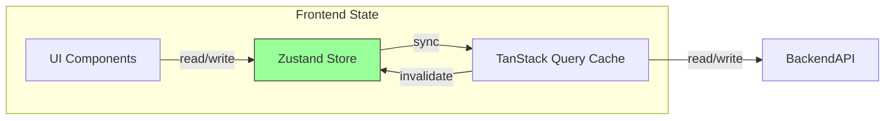

---

## 2. Backend Architecture Graph

### 2.1 High-Level Architecture

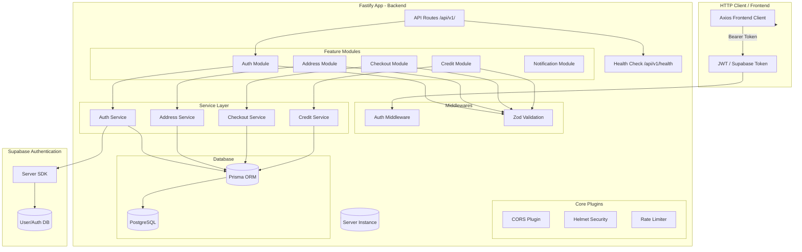

---

### 2.2 Module Dependency Graph

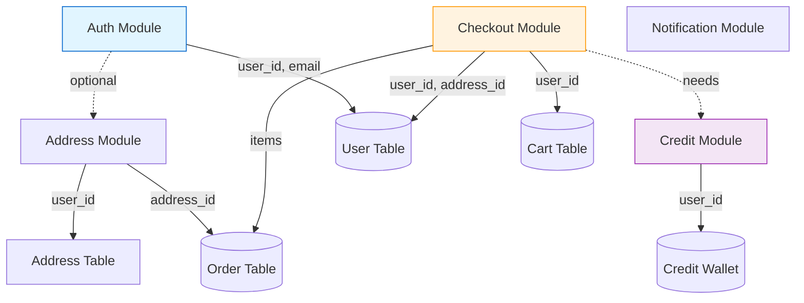

---

### 2.3 API Request Flow (Detailed)

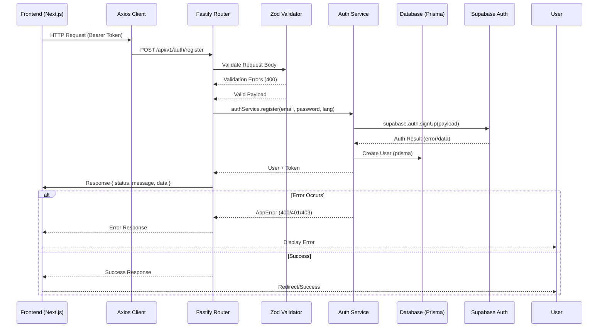

---

## 3. Database Schema Graph

### 3.1 Entity Relationship Diagram

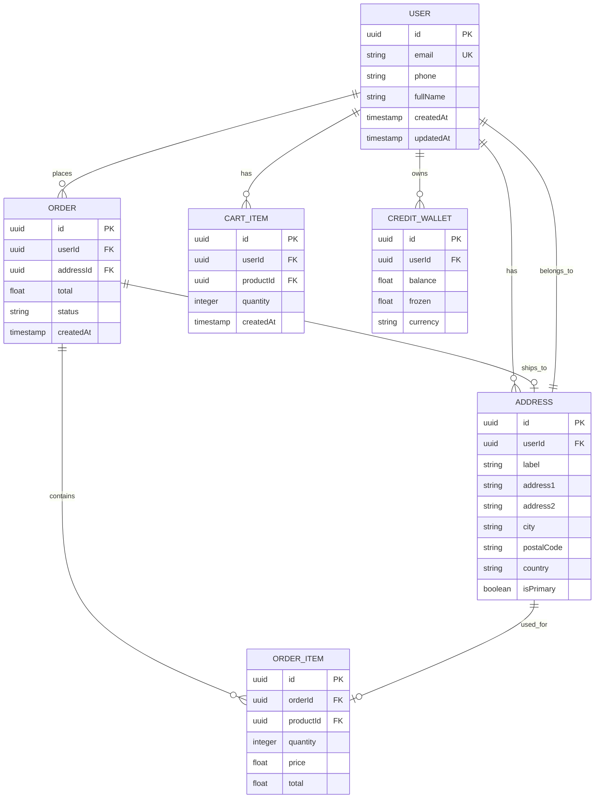

---

### 3.2 Module -> Table Mapping

| Module | Entity | Operations |
|--------|--------|------------|
| **Auth** | `USER` table | Register, Login, Update Profile, Token Generation |
| **Auth** | `Supabase Auth` tokens | JWT & Supabase Auth tokens |
| **Addresses** | `ADDRESS` table | CRUD, Set Primary |
| **Addresses** | `USER` table | Query addresses by user |
| **Checkout** | `ORDER` table | Create Order, Track Status |
| **Checkout** | `ORDER_ITEM` table | Add Items, Calculate Total |
| **Checkout** | `CART_ITEM` table | Read Cart Items |
| **Checkout** | `ADDRESS` table | Get shipping address |
| **Credit** | `CREDIT_WALLET` table | Manage Balance, Transactions |
| **Notifications** | (Not yet defined) | Pending implementation |

---

## 4. Feature Module Dependency Layers

### 4.1 Layered Architecture

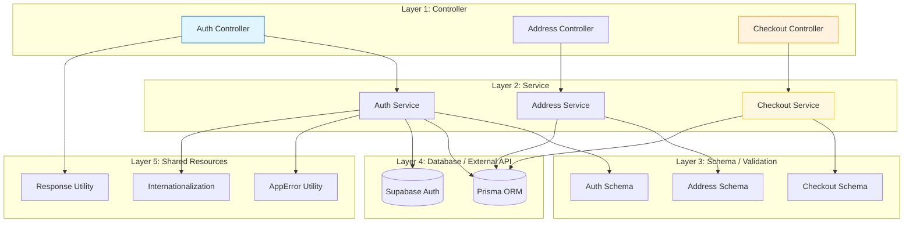

---

## 5. Frontend API Integration Graph

### 5.1 Axios Client Setup

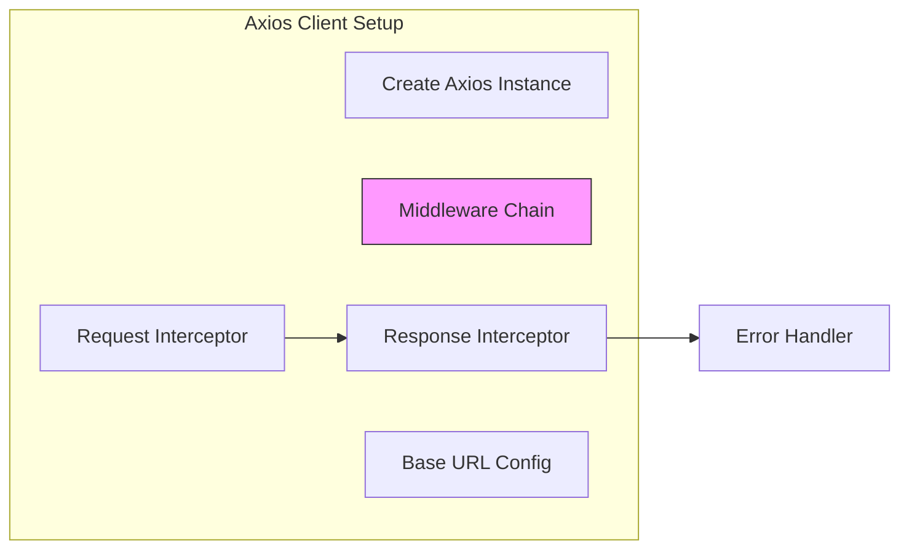

### 5.2 TanStack Query Data Flow

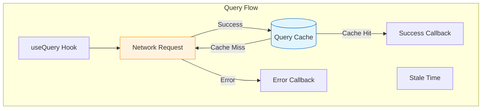

---

## 6. Authentication Flow Graph

### 6.1 Complete Auth Flow

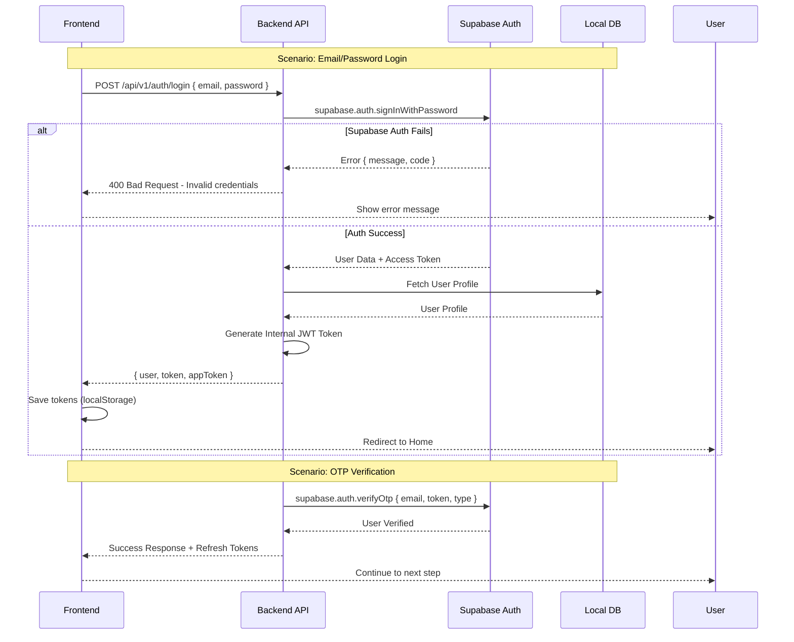

---

## 7. Performance Optimization Graph

### 7.1 Database Query Optimization

```mermaid
graph TB
    subgraph RawQuery[Raw Prisma Query]
        SelectAll[SELECT * FROM users]
        CrossJoin[CROSS JOIN or JOIN]
        ApplyFilter[WHERE filter]
        FetchAll[fetchAll()]
    end

    subgraph OptimizedQuery[Optimized Query]
        Project[PRISMA SELECT: {id, name, email}]
        Where[WHERE: WHERE email = $1]
        Limit[LIMIT: LIMIT 20]
        Skip[SKIP: SKIP offset]
        First[first()]
    end

    subgraph SchemaIndex[Schema Indexing]
        EmailIndex[@@index([email])]
        UserIdIndex[@@index([userId])]
    end

    SelectAll --> FetchAll
    Project --> First

    FetchAll -. no index -.-> SlowExecution[Slow Execution]

    Where & Limit & Skip --> First
    Project & Where --> FastExecution[Fast Execution]

    SlowExecution --> ReindexRecommendation["Recommend: Add Index"]
    FastExecution --> QueryOk["Query is Fast"]

    style SlowExecution fill:#ffebee,stroke:#d32f2f
    style FastExecution fill:#e8f5e9,stroke:#2e7d32
```

---

## 8. Common Error Scenarios

### 8.1 Error Flow Diagram

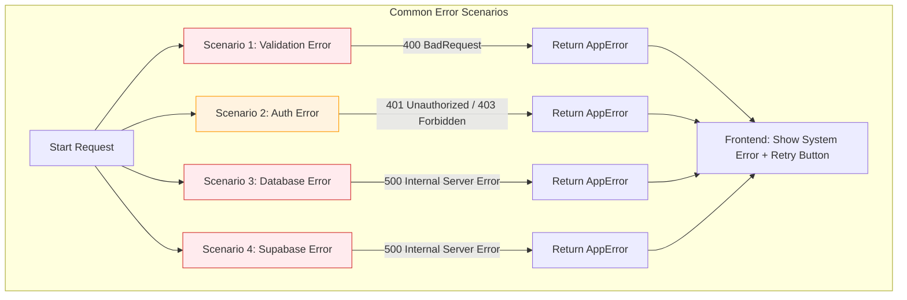

---

## 9. Interactive Arrows

### 9.1 Development Workflow

```mermaid
graph LR
    A[Start Development] --> B[Read Code Graph]
    B --> C[Upsert New Module]
    C --> D[Follow Architecture]
    D --> E[Run Matpock Skills]
    E --> F[Validate with Linting]
    F --> G[Push to Git]
    G --> H[Deploy to Production]

    style B fill:#e1f5ff,stroke:#0066cc
    style E fill:#fff3e0,stroke:#ff9800
    style H fill:#e8f5e9,stroke:#2e7d32
```

---

## 10. Glossary

| Term | Description |
|------|-------------|
| **PascalCase** | Naming convention untuk component class (TijarahButton) |
| **camelCase** | Function variable naming (getUserData) |
| **UPPER_SNAKE_CASE** | Constants (MAX_RETRIES) |
| **UUID** | Universally Unique Identifier for database keys |
| **Design Tokens** | CSS custom properties untuk konsistensi (var(--primary-sage)) |
| **Prisma ORM** | Database toolkit untuk type-safe queries |
| **TanStack Query** | Data fetching & caching library |
| **NextUI** | React UI library untuk UI components (base untuk Tijarah components) |
| **Zod** | Runtime validation library untuk TypeScript schemas |
| **Design System** | Set standard untuk warna, typography, spacing |

---

**Last Updated:** 2026-10-15
**Version:** 1.0.0
**Maintained by:** Tijarah Team